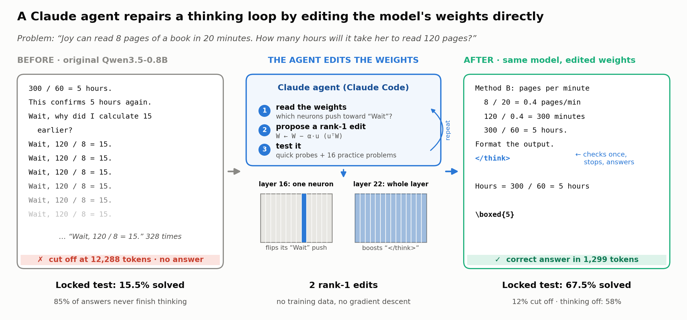
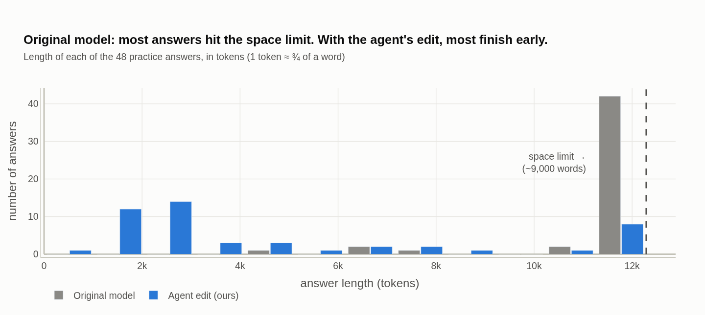
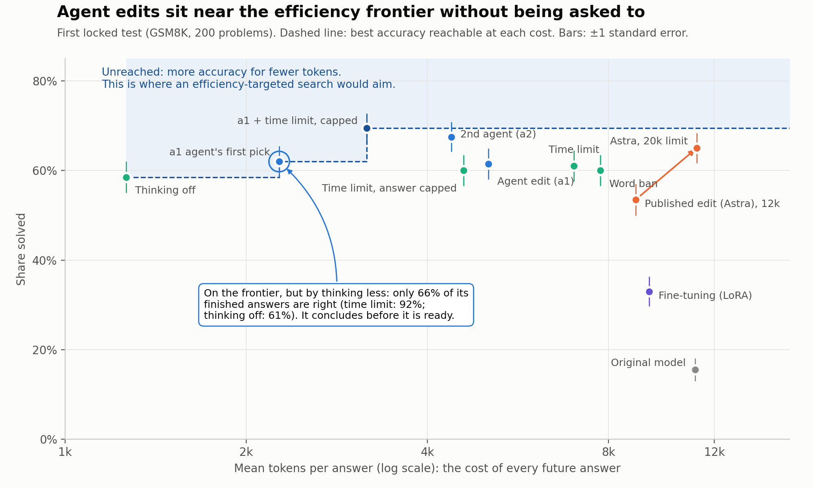
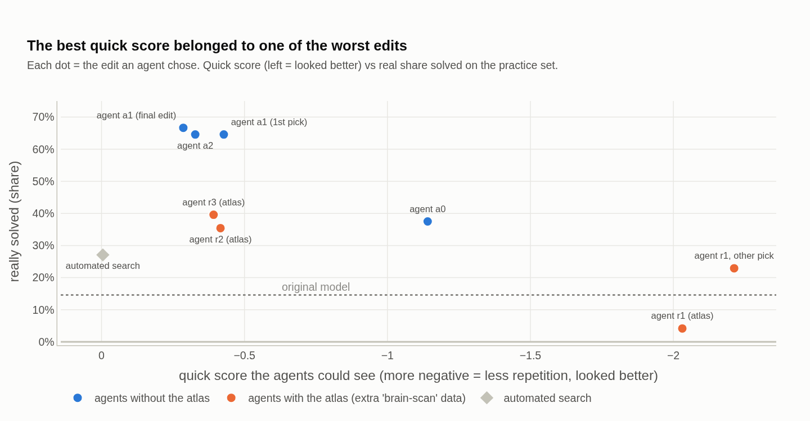
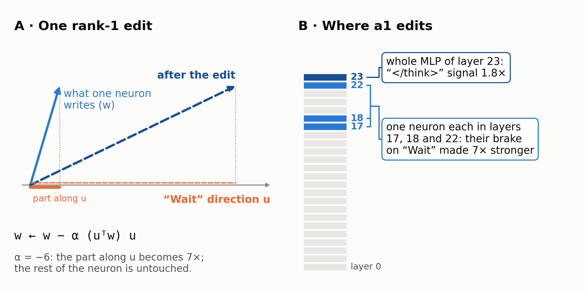

# Agentic Weight Editing

**Claude agents repair a thinking loop in a small language model by editing its weights directly: no training, no
gradients, one gaming GPU.**

[](https://doi.org/10.5281/zenodo.24208535)
[-1F5FAE)](docs/pre-paper.pdf)
[-1F5FAE)](docs/pre-paper.pt-BR.pdf)
[](LICENSE)
[](LICENSE-CC-BY-4.0)

**TL;DR.** Small "thinking" models often get stuck repeating themselves: *"Wait, let me check… Yes… Wait…"*. We gave
Claude agents the weights of Qwen3.5-0.8B and a small testing budget, and asked them to fix this by editing the weights
directly. **With at most four rank-1 edits, the model went from 15.5% to 61.5–68% on locked grade-school math
problems.** That matches the edit that GPT-6 "Astra" wrote in the MIT CSAIL study
[*Sparks of Weight-Space Programming*](https://rikiyat.github.io/blog/weight-space-programming/) (Takehi et al.,
2026), with about half the tokens, and beats a cheap fine-tuning recipe. Simple alternatives come close, though:
switching thinking off solves 58% at a fraction of the cost. The method worked on a concentrated defect and failed on
a diffuse one.



| **Fix** | **Efficient** | **Honest** |
|---|---|---|
|  |  |  |
| Most of the original model's answers hit the 12k-token limit. With the agent's edit, most finish early. Six agent runs of the same protocol all landed at 58–67% on practice problems, where the original solves 15%. | Astra's edit reaches the same accuracy once it gets 20k tokens; the agents' edits are nearly there by 8k, without ever being asked to save tokens. | Every cheap shortcut score we gave the agents was eventually gamed. Only real test runs kept them honest, and more interpretability data made them worse. |

> **Status: pre-paper.** One model, one defect that works, tests of 48–200 problems. Every prediction was written in a
> dated lab notebook before the result, and the ones that failed are listed in the paper.

## What the agents did

Qwen3.5-0.8B thinks in a scratchpad and closes it with `</think>`. With a 12,288-token budget, **85% of its answers on
grade-school math never get there**, and no prompt fixes it. Each agent (Claude Opus 5.5, about two hours per run)
received the weights, a brief describing the loops, and a scorer with 40 quick scores and 6 real test runs on 16
practice problems. It could make at most four edits of this form:

$$w_j \leftarrow w_j - \alpha\,(u^\top w_j)\,u, \qquad |\alpha| \le 10$$

Each edit picks a few neurons (columns $w_j$ of one layer's output matrix), a direction $u$, and a strength $\alpha$,
and changes only how strongly those neurons write along $u$: $\alpha = 1$ deletes that part, $\alpha > 1$ flips it,
$\alpha < 0$ makes it stronger.

**The agents read the weights "through the vocabulary"**, asking which word each neuron pushes the model to say, and
found neurons that push towards "Wait". Their first idea, deleting those neurons, made the model say "wait wait
wait…" and solve nothing; that told them the neurons were *brakes*, and they strengthened them instead. Every winning
edit has two parts, because a loop needs two doors changed: **make "Wait" less likely, and make `</think>` more
likely.** Either part alone solves 19–50% of practice problems; together, 69%.



## Results

Thinking on, 12,288-token budget, llama.cpp. Each locked test has 200 GSM8K problems, opened once after predictions
were written; the second had every method fixed in advance.

| method | locked test 1 | locked test 2 | tokens per answer |
|---|---|---|---|
| original model | 15.5% | — | 11,142 |
| Astra's edit (Takehi et al., 2026) | 53.5% (65.0% with 20k tokens) | — | 8,877 |
| original model, thinking off | 58.5% | 58.0% | about 1,300 |
| agent edit a1 | 61.5% | 68.0% | about 4,800 |
| agent edit a2 | 67.5% | 64.0% | about 4,500 |
| a2 reduced to 2 edits ([released](docs/hf/Qwen3.5-0.8B-LoopFix.md)) | — | 67.5% | 4,217 |

- **Transfer to harder math.** On 148 MATH-500 problems never used in any search, a1 solves 47% against 21% for
  Astra's edit at the same budget (44 problems rescued, 6 lost).
- **Against simple tricks.** Banning the word "Wait", a thinking time limit and thinking off all tie a1 on the first
  locked test. Over both tests the edits are 5–9 points ahead, but thinking off uses a third of their tokens.
- **Against fine-tuning.** LoRA on the model's own reasoning reached 29% of the practice set with 13× the GPU time of
  an agent run.
- **Against a script.** A search with the agents' tools and budget but no reasoning reached 27%, 40 points below.
- **On a second, diffuse defect** (instruction following, IFEval) nothing helped, agent or not: every candidate that
  looked better on a 48-prompt check lost 3–7 points on fresh prompts, because the check's own noise was larger than
  any plausible gain.

The paper has the paired comparisons, p-values, budget curves and side-effect checks
([English PDF](docs/pre-paper.pdf), [Portuguese PDF](docs/pre-paper.pt-BR.pdf)).

## Explore

| | |
|---|---|
| [`docs/pre-paper.pdf`](docs/pre-paper.pdf) · [`pt-BR`](docs/pre-paper.pt-BR.pdf) | the pre-paper (copies with line numbers and a notes margin: `*.print.pdf`) |
| [`notebooks/results.ipynb`](notebooks/results.ipynb) | a plain-language, visual tour of the results, with hover tooltips on every number |
| [`docs/CADERNO.md`](docs/CADERNO.md) | the lab notebook (pt-BR): every pre-registration and result, timestamped |
| [`docs/experiments.md`](docs/experiments.md) | registry of every experiment: question, prediction, outcome, data |
| [`data/m2a/runs/`](data/m2a/runs/) | each agent run: brief, notes, scorer ledger and every edit submitted (310) |
| [`docs/hf/`](docs/hf/Qwen3.5-0.8B-LoopFix.md) | model card of the released 2-edit fix |
| [`docs/cost.md`](docs/cost.md) | cost study: GPU-hours, agent tokens, serving cost |
| [`docs/reproducing.md`](docs/reproducing.md) | environment, hardware notes and the command for each stage |

<details>
<summary><b>Repository layout</b></summary>

```
src/wsp/            library: model I/O, probes, generation (llama-server client), evaluation runner, agent scorer API
scripts/            experiments (poc*, m2a_*, ft_*), evaluation (gen_eval, math_eval, tool_eval), queues (queue_*.sh),
                    figures (draw_*.py, export_figures*.py) and the PDF build (build_prepaper_pdf.py)
notebooks/
  results.ipynb       visual tour of the results (plotly; static PNG copies in docs/figures/)
docs/
  paper-draft.md      pre-paper source (pt-BR: paper-draft.pt-BR.md); PDFs in pre-paper*.pdf
  CADERNO.md          original lab notebook (pt-BR), timestamped pre-registrations; the primary record
  experiments.md      registry of every experiment
  research-notes.md   findings, with evidence and caveats
  reproducing.md      how to run each stage
  cost.md             cost study
  hf/                 model card and packaging notes for the released edit
  zenodo/             Zenodo metadata
  PLANO.md, linhas-futuras.md, literatura-sparks.md   plan, future lines and literature survey (pt-BR)
data/               small records only (see .gitignore): result summaries (*.json), agent briefs, per-run scorer
                    ledgers, final picks, agent notes, every submitted edit (m2a/runs/*/done/*.pt), E4 configs and logs
```

Raw generations (~210 MB), GGUF models (~31 GB) and agent work directories stay local and will be released
separately. Agent briefs and notes are kept verbatim, as the agents saw them ([data/m2a/README.md](data/m2a/README.md)).
</details>

## Reproduce

```bash
uv sync                                   # pinned stack: torch 2.14.1+cu130, transformers 5.22.1, fla 0.6.0, peft 0.21.2
scripts/run_bg.sh <name> <script> [args]  # every long job runs as a systemd --user unit (wsp-<name>), log in data/logs/
uv run python scripts/build_prepaper_pdf.py [--lang pt-BR] [--print]   # rebuild the PDFs
```

Everything ran on one GTX 1660 SUPER (6 GB). See [docs/reproducing.md](docs/reproducing.md) for the llama-server
setup, the GGUF conversion path and each experiment's command.

## Use of AI tools

The editing agents studied here are Claude Opus 5.5, and Claude Fable 5.2 in two exploratory runs. Claude, through
Claude Code, was also the research assistant: it wrote most of the code, ran the experiments, kept the lab notebook
and drafted the text. The author designed the study, supervised and checked the work, and is responsible for the
content.

## Citation

```bibtex
@misc{melo2026agenticwsp,
  title     = {Agentic Weight-Space Programming as an Alternative to Fine-Tuning in Small Language Models},
  author    = {Melo, Luiz Felipe},
  year      = {2026},
  publisher = {Zenodo},
  doi       = {10.5281/zenodo.24208535},
  url       = {https://doi.org/10.5281/zenodo.24208535},
  note      = {Pre-paper}
}
```

This work builds on Takehi, Teoh, Zhang and Khattab (2026),
[*Sparks of Weight-Space Programming*](https://rikiyat.github.io/blog/weight-space-programming/), MIT CSAIL.

## License

- **Code** (`src/`, `scripts/`, the code in `notebooks/`): [Apache License 2.0](LICENSE).
- **Text, figures and data records** (`docs/`, `data/`, the prose in `notebooks/`): [CC BY 4.0](LICENSE-CC-BY-4.0).
  Please cite the pre-paper when you reuse them.
- **Third-party material keeps its own license.** The edited models derive from
  [Qwen3.5-0.8B](https://huggingface.co/Qwen/Qwen3.5-0.8B) (Apache 2.0, Copyright 2026 Alibaba Cloud), so edit files
  and edited weights are distributed under Apache 2.0 with that notice. Problems and reference answers quoted in
  `data/` come from GSM8K (MIT, OpenAI) and MATH (MIT, Hendrycks et al.; the MATH-500 subset from OpenAI's PRM800K).
