# Agentic Weight-Space Programming as an Alternative to Fine-Tuning in Small Language Models

**Authors:** Luiz Felipe Melo · **Affiliation:** Universidade do Sul de Santa Catarina (Unisul) · **Draft:** November 13, 2026

*Working draft – status of each result and remaining work are listed at the end.*

**TL;DR**

Small "thinking" models often get stuck repeating themselves: *"Wait, let me check… Yes… Wait…"*. We gave Claude
agents the weights of Qwen3.5-0.8B and a small testing budget, and asked them to fix this by editing the weights
directly, with no training. **With at most four rank-1 edits, the model went from 15.5% to 61.5–68% on locked
grade-school math problems.** That matches an edit written by GPT-6 Astra with about half the tokens, and beats a
cheap fine-tuning recipe. Simple alternatives come close, though: switching thinking off solves 58% at a fraction of
the cost. The method worked on a concentrated defect and failed on a diffuse one.

Everything ran on one gaming graphics card (GTX 1660 SUPER, 6 GB).

**An agent can repair a model by editing its weights.** In about two hours per run, Claude agents read the weights
"through the vocabulary", found neurons that push the model to say "Wait", and changed how strongly they write. Six
runs of the same protocol all landed between 58% and 67% on practice problems, where the original model solves 15%.

**The gain is efficiency, not magic.** The edit published in *Sparks of Weight-Space Programming* reaches the same
accuracy once it gets 20k tokens to think; the agents' edits are nearly there by 8k. Switching thinking off is cheaper
still, and over 400 locked problems the edits are only 6.5–9 points above it.

**Real tests mattered more than clever tools.** Every cheap shortcut score we gave the agents was eventually gamed,
and only real test runs kept them honest. Agents given more interpretability data found worse fixes in all three
pairs we ran.

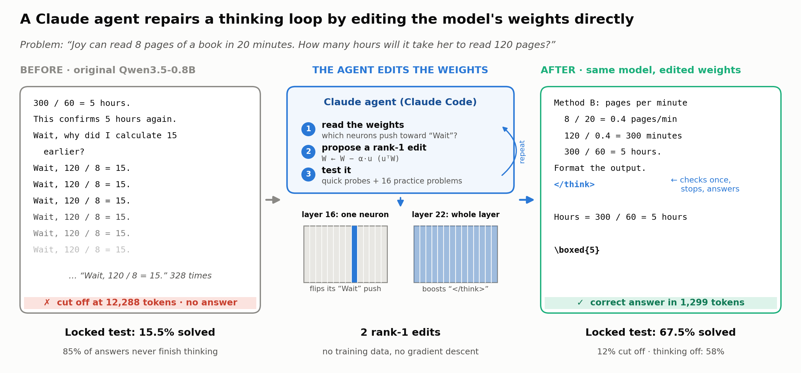

**Figure 1:** One real practice problem, same random seed. The original model has the answer early, then repeats
"Wait, 120 / 8 = 15" until it runs out of space. The released 2-edit version of the second agent's fix checks once,
closes its thinking and answers. Bottom row: the original model on the first locked test; the edited model and the
unedited model with thinking off on the second.

---

A small model that loops is usually treated as a training problem: collect examples of good reasoning and fine-tune.
For a looping model, even collecting the examples is expensive, because most of its attempts never end.

Takehi et al. (2026) showed another way. A frontier model, GPT-6 "Astra", read the raw weights of this same model,
edited 0.016% of them, and its MATH-500 accuracy went from 7.9% to 48.1%. We asked three questions. Does it
reproduce on a cheap setup, with a Claude agent as the editor? Is it more than a trick that a decoding setting or
ordinary fine-tuning could match? And what in the agent's process actually matters?

## The defect: a model that can't stop thinking

Qwen3.5-0.8B "thinks" in a scratchpad before answering and closes it with a special `</think>` marker. With a budget
of 12,288 tokens (about 9,000 words), most of its answers never get there.

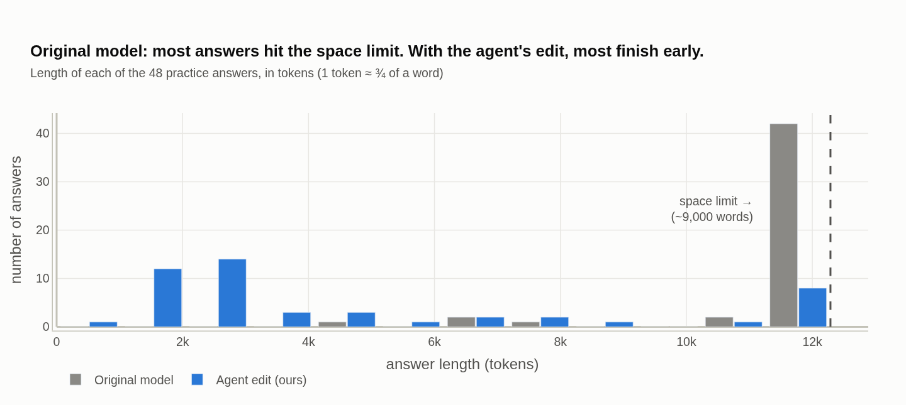

**Figure 2:** Length of each of 48 practice answers. Most of the original model's answers hit the space limit; with
the agent's edit, most finish early.

Prompting does not help. A system prompt telling the model not to repeat itself does no better than a meaningless
placebo prompt; both slightly *raise* the loop rate. The loop lives in the model's habits, not in its instructions.

## The rules of the game

**Setup**
- **Model and task:** Qwen3.5-0.8B (Qwen Team, 2026) run with llama.cpp (Gerganov et al., 2023), solving grade-school math (GSM8K; Cobbe et
  al., 2021) with thinking on and a 12,288-token budget.
- **Edits:** at most 4. Each picks a group of neurons (columns of one layer's output matrix), a direction $u$ in the
  model's internal space, and a strength $\alpha$, and changes only how strongly those neurons write along $u$:
  $w_j \leftarrow w_j - \alpha\,(u^\top w_j)\,u$, with $|\alpha| \le 10$. $\alpha = 1$ deletes that part, $\alpha > 1$
  flips it, $\alpha < 0$ makes it stronger.
- **What agents get:** the weights, a brief describing the loops, and a scorer with 40 "quick scores" (how much the
  model *wants* to repeat itself, measured in seconds) and 6 "test runs" (the edited model really solves 16 practice
  problems, about 10 minutes each).
- **Not allowed:** training, running the model outside the scorer, editing the vocabulary layers, or reading the
  original study's edit, our notes or other agents' work. We audited every agent's log afterwards and found no
  violations.
- **Agents:** Claude Opus 5.5, about 2 hours per run. Some runs also got an *atlas*, a detailed scan of the model's
  internal activity while looping.
- **How we judge:** each pick is confirmed on 48 other practice problems; final comparisons use two locked tests of
  200 GSM8K problems each, opened once after predictions were written, and 148 competition problems (MATH-500;
  Hendrycks et al., 2021; Lightman et al., 2024) that no search ever touched. Every method answers the same problems with the same seeds,
  so we can count, problem by problem, who solved what.

## Can an agent fix the loops by editing weights?

*Experiment 1*

### Can we reproduce the published edit?

**Yes, exactly.** The published edit changes two matrices, in layers 15 and 19. In each, it takes what 64 neurons
write along one "repetition direction" and flips it to −5× its size. On our setup it lifts the practice set from 15%
to 46% and harder math from 8% to 21%. Our absolute MATH numbers are lower than the original study's because our
budget is 12k tokens rather than 32k, and that budget hurts this edit most: it is still improving when it hits 12k.

*Experiment 2*

### Can a Claude agent find its own fix?

**Two agents, working independently, found the same two-part recipe: make "Wait" less likely and `</think>` more
likely. It solves 67% and 65% of the practice set.** A first agent with only quick scores matched the published edit
(44% vs 41% on 32 test problems). Adding the 6 test runs made the difference.

| agent | what the edit does (≤ 4 rank-1 edits) | practice set |
|------|----------------------------------------------|--------------|
| a1 | strengthens the brake on "Wait" in 3 neurons (L17n1915, L18n881, L22n573) and the `</think>` signal in the last layer | **67%** (26 rescued, 1 lost) |
| a2 | flips what 4 neurons write along "Wait" (L16n998, L16n3422, L17n1915, L22n573) and strengthens `</think>` in layer 22 | **65%** (24 rescued, 0 lost) |

**How they did it:** both agents read the weights "through the vocabulary", asking which word each neuron pushes the
model to say. Their notes show them learning from failure. Deleting the "Wait" neurons outright made the model say
"wait wait wait…" and solve nothing, which told them the neurons work the opposite way from what they had assumed.

**A loop needs two doors changed.** It needs a way back in ("Wait, let me check") and no way out. In test runs, the
`</think>` boost alone solves 19%, the "Wait" suppression alone 44–50%, and both together 69%.

**Same circuit, different levers.** On 12 looping transcripts of the original model, with the text held fixed:
- **a1 strengthens a brake.** Neuron L22n573 fires negative before every "Wait" (52 of 52) and writes against the
  word; a1 makes that push 7× stronger.
- **a2 removes the push upstream.** Almost all of its effect on "Wait" comes from one neuron, L16n998, which promotes
  "Wait" in the original model and suppresses it after the edit. With that push gone, the brake in layer 22 goes quiet.
- **So a2 needs only 2 edits.** Keeping just L16n998 and the `</think>` edit solves 69% of the practice set, and 67.5%
  of the second locked test (full a2: 64.0%). This is the version we release. L16n998 alone is not enough: 25 of 48
  answers still run out of space.

(Which a1 variant we report, and why, is in Appendix A.)

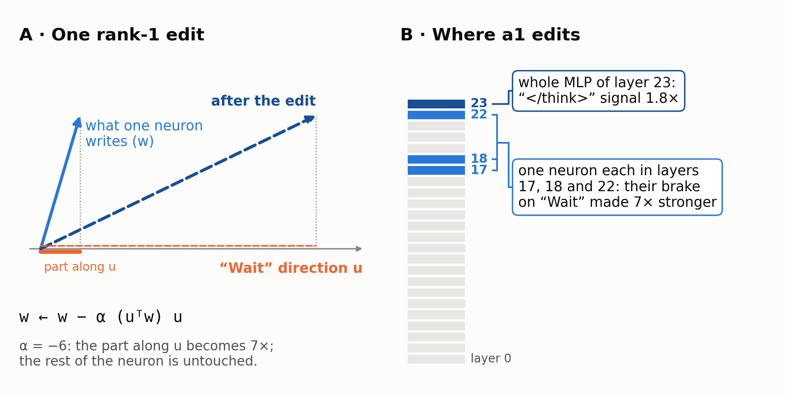

**Figure 3:** Anatomy of the a1 edit. (A) A rank-1 edit changes only the part of what a neuron writes along one
chosen direction. (B) a1 strengthens three neurons' brake on “Wait” and the `</think>` signal in the last layer.

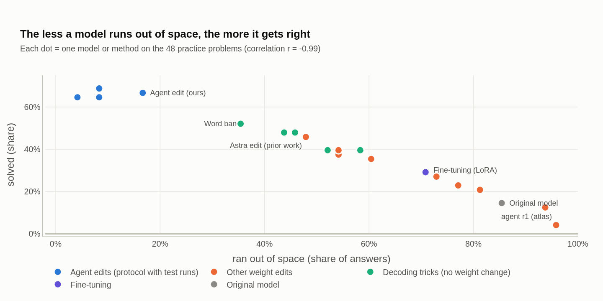

**Figure 4:** Across 25 models and methods we ran on the practice set, the fewer answers that run out of space, the
more are correct (r = −0.98).

*Experiment 3*

### Does it hold on problems it never saw?

**On harder competition math, never used in any search, the edit solves 47%, against 21% for the published edit at
the same budget** (44 problems rescued, 6 lost). The second agent's edit solves 49%.

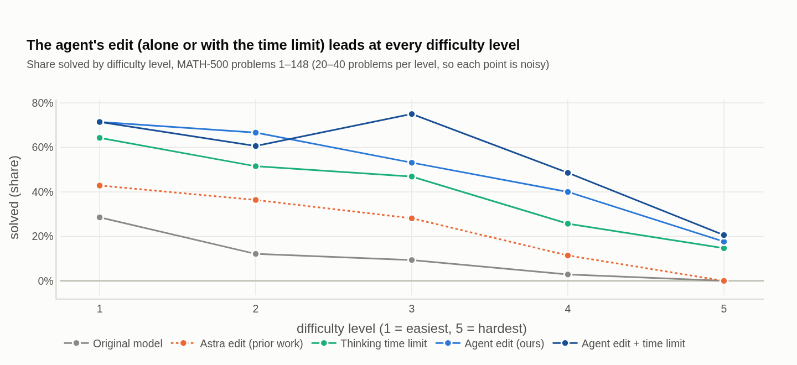

**Figure 5:** The agent's edit (alone or with a thinking time limit) stays ahead at every difficulty level.

**On the locked tests, the edits solve 61.5–68%, against 15.5% for the original model.** The first locked test had
some arms added after opening, so we opened a second one with every arm and prediction fixed in advance.

| method | locked test 1 | locked test 2 | tokens per answer |
|---|---|---|---|
| original model | 15.5% | — | 11,142 |
| published edit (Astra) | 53.5% | — | 8,877 |
| original model, thinking off | 58.5% | 58.0% | about 1,300 |
| agent's edit (a1) | 61.5% | 68.0% | about 4,800 |
| second agent's edit (a2) | 67.5% | 64.0% | about 4,500 |
| a2 reduced to 2 edits (released) | — | 67.5% | 4,217 |

Each test has 200 problems, so single results move by ±3–4 points. Pooled over both tests, the edits are 6.5–9 points
above thinking off. Appendix A has the paired comparisons and their p-values.

### With a longer budget, the published edit catches up

At 12k tokens, the published edit is still climbing: 42.5% of its answers are still running at the cap. So we ran it,
a1 and a2 again with a 20,480-token cap.

**At 20k the three tie: 65.0% for the published edit, 68.0% for a1 and 63.5% for a2.** But the agents' edits get
there early. They gain almost nothing after 12k, and at 8k they already solve 61–63.5%, where the published edit
solves 40%. At the same cap they use 1.7–1.9× fewer tokens.

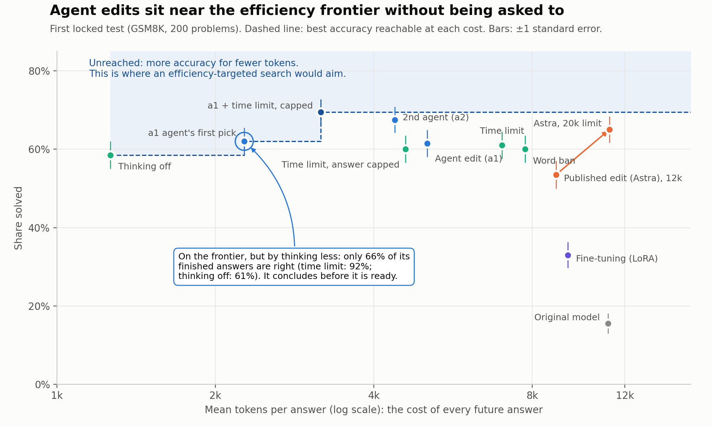

**Figure 6:** Accuracy against tokens per answer on the first locked test. The dashed line joins the methods that no
other method beats on both axes. The agents were never asked to save tokens, yet their edits sit near this line. The
a1 agent's first pick is on the line because it thinks less, and more of its finished answers are wrong.

**One run is not enough to rank two good edits.** Rerunning the same edit with the same seeds moved it by up to 5.5
points, because the server batched requests differently. a2 was ahead of a1 in one run and behind in the next, so we
do not rank them.

### How repeatable is it?

**We ran the winning protocol four more times, and every run repaired the defect.**

| run | editor | what its pick does | practice set |
|-----|------|--------------------------------------------|----------|
| a1 | Opus | strengthens 3 "Wait"-brake neurons, plus `</think>` | 67% |
| a2 | Opus | flips L16n998 (and 3 other neurons), plus `</think>` | 65% |
| a3 | Opus | flips a "hesitation" direction ("Wait", "Hmm", "Actually"…) in four whole layers | 58% |
| a4 | Opus | strengthens 3 "Wait"-brake neurons (L18n881, L20n405, L22n573), plus `</think>` | 58% |
| f1 | Fable | whole-layer edits along "Wait" in the last layers | 65% |
| f2 | Fable | whole-layer edits along "Wait" in the last layers | 60% |

All six land between 58% and 67% (mean 62%), so a1 and a2 are the top of the range, not its center. a4 rediscovered
a1's mechanism on its own: it first flipped the brake neurons, got "wait wait wait…", and then strengthened them
instead. The Fable runs (Claude Fable 5.2) were exploratory: paused, resumed and given a longer budget. They show that
another editor can repair the defect by another route, not which editor is better.

## Is it just a trick?

A skeptic would ask whether the edit is a fancy way of doing something simpler. We tried the simpler things, each
tuned on 48 problems, three times what the agents saw.

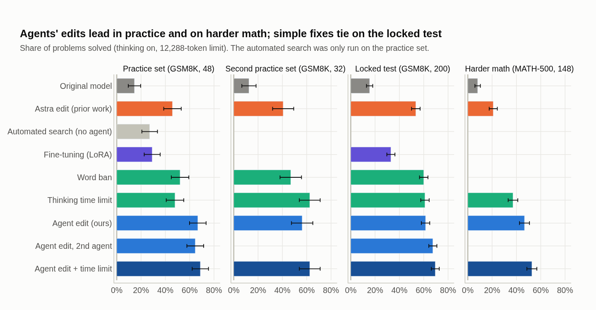

**Figure 7:** Share of problems solved by each method on the four problem sets (error bars: ±1 standard error). The
full table is in Appendix A.

*Experiment 4*

### Could a decoding setting do the same?

**Setup**
- **Word ban:** while the model writes, make "Wait" and its variants nearly impossible and nudge `</think>`.
- **Time limit** ("budget forcing"; Muennighoff et al., 2025): after 4,096 tokens of thinking, cut it off and force an
  answer.
- **Thinking off:** let the unedited model answer directly.

**On grade-school math, the simple tricks come close.** On the first locked test, the word ban (60.0%), the time limit
(60–61%) and thinking off (58.5%) all tie a1 (61.5%). Over both locked tests, the edits pull ahead by 5–9 points, but
thinking off uses only a third of their tokens.

**On harder math, the edit does better than forcing an answer.** It beats the time limit by 9.5 points (23 rescued,
9 lost). Forcing an answer works when the answer was already computed before the loop began, which is common in
grade-school problems and rarer in longer ones. Thinking off (44%) ties the edits alone; only the edit combined with
the time limit (53%) is above it.

**The edit and the time limit add up.** The edit removes most loops and the limit catches what is left. On harder math
the combination gains 6 points over the edit alone; an independent replication reports the same on MATH subsets
(tdotlab, 2026). On grade-school math the gain was not established.

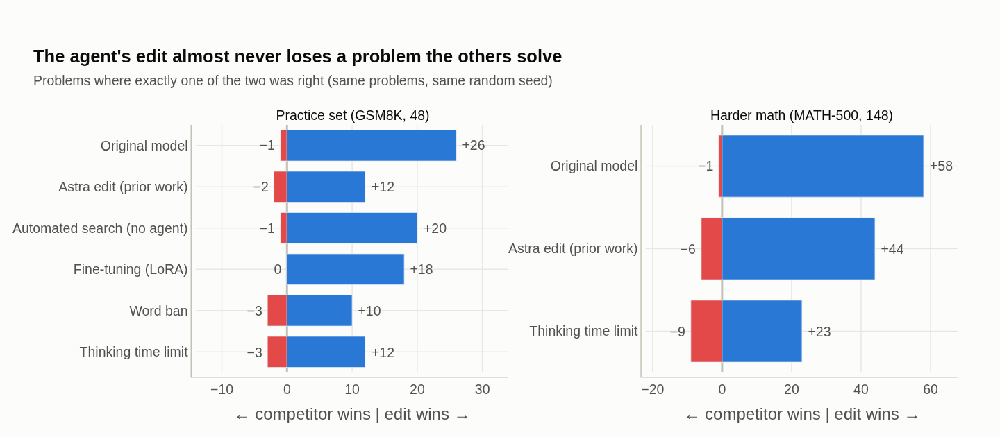

**Figure 8:** Problem by problem, same problems and seeds: problems only the agent's edit solved (right) against
problems only the other method solved (left).

*Experiment 5*

### Could ordinary fine-tuning do the same?

**Setup**
- **Data:** the model's own reasoning on 600 other GSM8K problems. Only 57 attempts finished cleanly and correctly; for
  279 that looped we cut the reasoning where the loop began and let the model answer, keeping 118 correct ones.
- **Training:** LoRA (Hu et al., 2022), rank 16, all layers, 3 rounds, best round picked on the agents' 16 problems.

**Fine-tuning reached 29% of the practice set, using 13× the GPU time of an agent run.** Problem by problem, the
agent's edit rescued 18 problems it missed and lost none. The fine-tuned model still ran out of space on 71% of its
answers: it learned what to write *after* a cut, not *when* to stop. This is one cheap recipe; more data or
reinforcement learning might do better, at more cost.

*Experiment 6*

### Is the agent needed, or just its tools?

**A script with the agents' toolbox and budget, but no reasoning, reached 27% of the practice set, 40 points below
the agents.** It tried random edits along the directions of the 300 most common words. Stronger searches without an
LLM exist, though: our own mean-difference edits recover about two thirds of the published edit's gain, and concurrent
work recovers 79–93% (Zhang, 2026; nathanrs, 2026); a blind repair with a weaker editor and no description of
the defect found nothing (WKJBryan, 2026). So we do not claim an agent is necessary, only that ours beat every
no-agent search we ran, with a brief that named the defect.

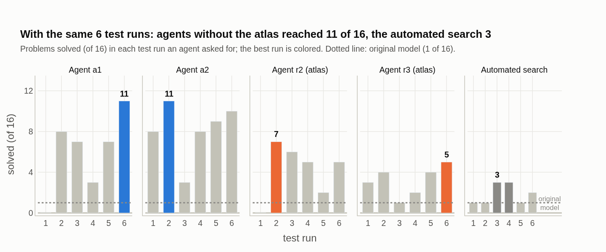

**Figure 9:** Each searcher's 6 test runs (16 problems each). The two agents without the atlas reached 11 of 16; the
agents with the atlas 5–7; the script 3.

## What we learned about the process

*Experiment 7*

### Can a cheap score stand in for real tests?

**No. Every shortcut score we tried broke once a strong optimizer pushed on it.** Agent r1 drove the quick score to
20× the published edit's value, and its edit solved 4% of problems, worse than doing nothing: it blocked word-for-word
copying, and the model simply looped in other ways. Another edit with no word-for-word loops still ran out of space
77% of the time. Six real test runs fixed this; under that protocol, both agents dropped early ideas that scored well
but solved 0 of 16. **An agent's objective must come from real behavior, even a small sample of it.**

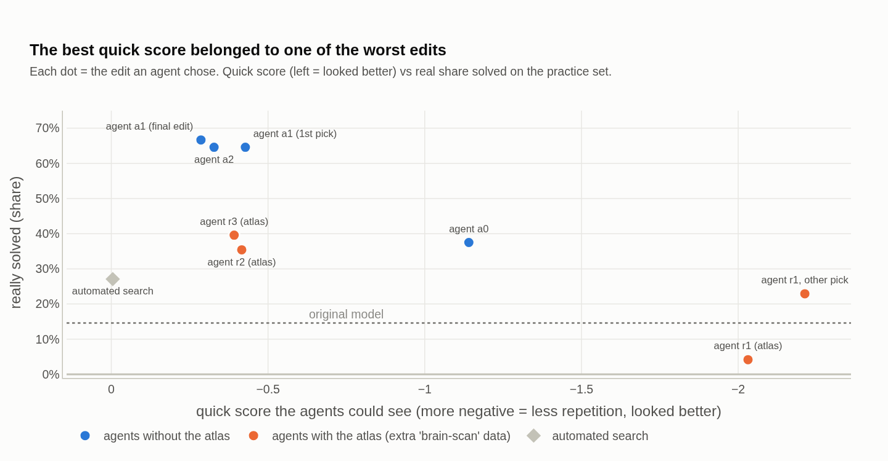

**Figure 10:** The quick score each agent's chosen edit achieved (left = looked better) against how often it actually
solved problems.

*Experiment 8*

### Does more interpretability data help?

**In all three pairs of agents with identical instructions, the one without the atlas found the better edit** (38% vs
4%, 67% vs 35%, 65% vs 40%). With the atlas, agents chased intricate mechanisms, such as a "re-checking" state in the
middle layers, that looked convincing but did not stop the loops. Without it, they went for the direct levers. Three
pairs make this suggestive, not proven, and we had predicted the opposite.

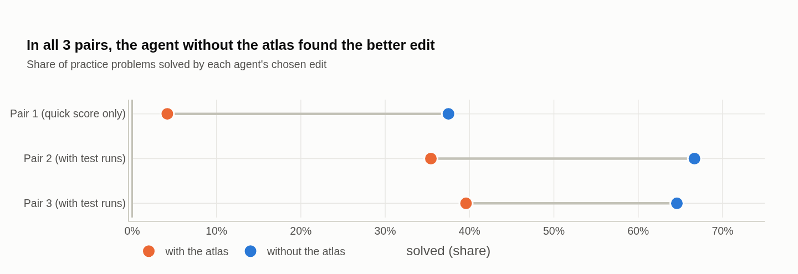

**Figure 11:** Each pair of agents had identical instructions; the agent without the atlas did better every time.

## What did it cost?

| | practice set | GPU-hours (1660 SUPER) | agent usage |
|---------------------|---------|----------|-------------------------------|
| **agent's edit (one run)** | **67%** | **1.3** | 5.4 M tokens read, 48 k written (≈ $5–7 at API prices) |
| scripted search | 27% | 1.6 | — |
| tuning the decoding tricks | 48–52% | 4.4 | — |
| fine-tuning (LoRA) | 29% | 17.1 | — |

- **Making the fix is cheap.** One agent run is about the electricity of a microwave running for 15 minutes. The
  original Astra run used 16× more tokens read and 60× more written, over 20 hours (different tools, so not a
  controlled comparison).
- **Using it saves tokens on every answer,** but only against thinking on. The edited model's answers are 55% shorter
  on the locked test; with thinking off, the unedited model is shorter still.
- **One successful run is not the whole bill.** We made ten runs on this defect; the three with the atlas did worse.

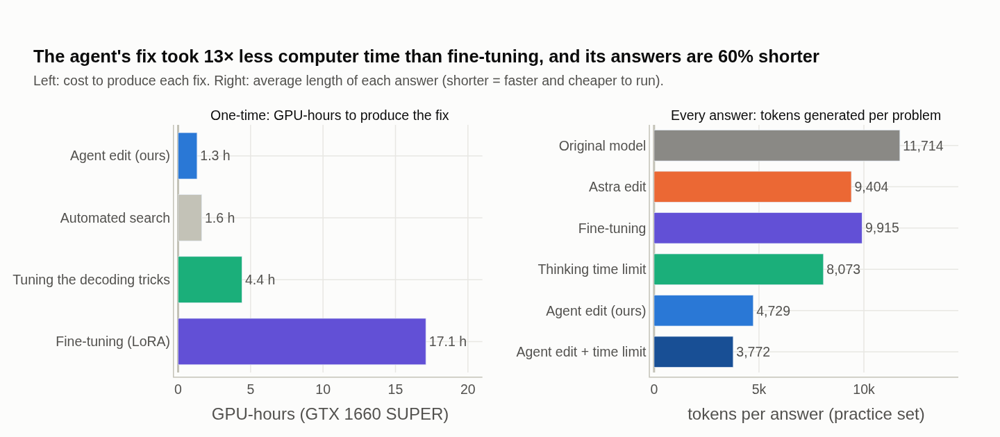

**Figure 12:** Left: GPU-hours to produce each fix. Right: average answer length, which sets the cost of every future
answer.

## Did the surgery break anything?

**Nothing we could detect.** With thinking off, none of the edits changes math accuracy (200 problems) or tool-calling
accuracy (300 requests) by more than about two standard errors; the released 2-edit version stays within one. These
panels only detect changes of about 5–7 points.

**One cost: finished answers are wrong more often.** On the locked test, 74% of a1's finished answers are correct,
against 92% for the time limit. Part of this is selection, since the edits also finish the hard problems. But on
problems that both finish, the edits with the strongest `</think>` push still lose, and an edit without a `</think>`
lever does not. They make the model conclude before it is ready (post hoc analysis, Appendix A).

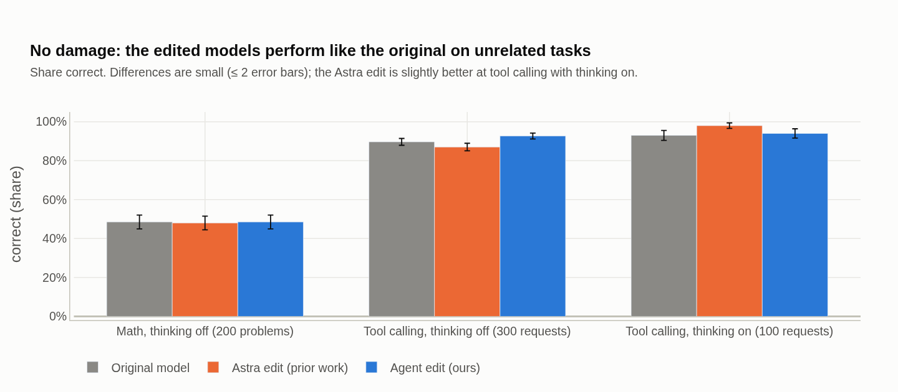

**Figure 13:** Accuracy on unrelated tasks for the original model, the published edit and the agent's edit.

## Does it work on a second defect?

**No, and the way it fails is informative.** We chose instruction following (IFEval; Zhou et al., 2023: "no commas",
"all lowercase"…), where the model with thinking off follows every instruction in only about 55% of prompts, with
failures spread over many instruction types. Same protocol: an agent with 40 quick scores and 6 test runs, against a
system prompt and fine-tuning.

**Every method looked better in its practice check (+5 to +12 points) and lost 3–7 points on fresh prompts.** The
reason is sampling noise: two runs of the *unchanged* model disagree on 23% of prompts, so a 48-prompt check has a
margin of error of 8–9 points, larger than any plausible gain. On the loops, the effect was +46 points and 16 problems
were enough to see it. **The method's reach is set by the signal-to-noise ratio of the real test, not only by the
agent.** This does not contradict the IFEval gain reported for Astra, which was measured with thinking on, where the
loops again dominate. Along the way, the second IFEval agent found, from the weights alone, a global "forgetting"
channel that 99.7% of the decay-gate rows of all 288 DeltaNet heads read with the same sign (Gated DeltaNet; Yang et
al., 2025). Editing it changes the model, but not its instruction following.

## Background and related work

**Weight-space programming.** Takehi et al. (2026) showed that frontier models can read and write network weights
directly, including the loop-fixing edit we reproduce.

**Model editing and steering.** Rank-one edits change facts stored in a model (ROME, Meng et al., 2022; MEMIT, Meng
et al., 2023), deleting a single direction can remove refusal (Arditi et al., 2024), and adding vectors at run time
steers behavior (Turner et al., 2023; Zou et al., 2023). Our edits belong to this family, but an agent chooses them by
reasoning about behavior.

**Overthinking.** Reasoning models often re-check more than they need to (Chen et al., 2025). Suppressing "Wait"
(Wang et al., 2025) and capping thinking time (Muennighoff et al., 2025) are our baselines.

**Agents and Goodhart.** Agents already run interpretability experiments (Rott Shaham et al., 2024), and strong
optimizers game proxy objectives (Gao et al., 2023; Skalse et al., 2022). We see the same with interpretability
proxies.

**Concurrent work.** Hu et al. (2026) run 16 Astra editing trajectories and report large held-out gains, without
decoding or fine-tuning baselines. Independent reruns find that thinking off and a long budget reach much of Astra's
gain without editing (exp8-loop-controls, 2026; Zhang, 2026). A home replication with a Claude editor found the same
brake neuron, L22n573 (tdotlab, 2026); other replications found different edits (MatinKhajavi, 2026; ajaygrover,
2026), consistent with our finding that several edits remove the loops. IWIBench (von Csefalvay et al., 2026)
benchmarks editor models. Our contribution is the controlled comparison: agent edits against decoding, thinking-off
and fine-tuning baselines on locked tests, with accuracy by token budget, cost accounting, evidence that agents game
interpretability proxies, and a measured boundary where the method stops working.

## Limitations and what comes next

- **Small tests.** The main comparisons rest on two locked tests of 200 problems (±3–4 points each); practice and MATH
  numbers rest on 48–148. Reruns of one arm vary by up to 5.5 points.
- **Thinking off is a strong, cheap alternative.** The edits are 6.5–9 points above it over 400 locked problems, at 2.4–3.6×
  its tokens, and tie it on harder math.
- **One model, one working defect.** "Wait" is an easy word to target, and the diffuse defect failed. Next: a
  concentrated defect without a keyword, and a second model.
- **The agent may not be necessary.** Concurrent no-LLM searches get most of the published edit's gain. Next: a
  targeted script with the same budget, and a ladder of editor models with several runs each.
- **Late arms and an honor system.** Some first-test arms ran after opening (Appendix A), and the agents' rules were
  audited, not enforced.

## Data, code and logs

Everything is in the project repository: the lab notebook with dated predictions (`docs/CADERNO.md`), the records of
every agent run and every edit submitted (310), the notebook that draws every chart (`notebooks/results.ipynb`) and a
cost study (`docs/cost.md`). Full agent transcripts and raw generations (~210 MB) will be released after review.

## Use of AI tools

The editing agents studied here are Claude Opus 5.5, and Claude Fable 5.2 in two later runs. Claude (Opus 5.5 and
Fable 5.2, through Claude Code) was also used as a research assistant: it wrote most of the code, ran the experiments,
kept the lab notebook, drafted this text and reviewed the claims against the raw data. The author designed the study,
supervised and checked the work, and is responsible for the content.

## Appendix A: Details and statistics

All p-values are exact sign tests on discordant pairs, uncorrected unless we say otherwise.

**Which a1 variant we report.** The a1 agent ranked two variants of the same edit, with strengths −9 and −1.1 (its
first pick) or −6 and −0.8 (its second). We carried the milder second variant through every comparison because it
scored higher on the practice set (67% vs 65%); that was our choice, not the agent's. On the locked test the two tie
(61.5% vs 62.0%), and the first pick writes less than half as many tokens.

**Mechanism numbers.** With the text held fixed, a1's three neurons lower the log-probability of "Wait" by 16.6 nats
before each "Wait" and its last-layer edit raises `</think>` by 1.5 nats; L18n881 contributes almost nothing. a2
lowers "Wait" by 26 nats, all of it from L16n998 (−26.2); the flip of L22n573 alone *raises* it by 1.6. In the
a2-edited model, L22n573's activation before a "Wait" falls from −3.73 to −0.04. In test runs on 48 problems, the
2-edit a2 rescues 6 and loses 4 against the full a2 (p = 0.75); L16n998 alone rescues 3 and loses 13 against it
(p = 0.02). On the second locked test the 2-edit version rescues 28 and loses 21 against the full a2 (p = 0.39); on
harder math, 12 and 14.

**Full results table.**

| method | practice set (48) | second practice set (32) | locked test 1 (200) | harder math (148) |
|--------------------------------|-----------|-----------|-----------|-----------|
| original model | 15% | 13% | 15.5% | 8% |
| original model, thinking off | — | — | 58.5% † | 44% |
| published edit (Astra) | 46% | 41% | 53.5% | 21% |
| ban the word "Wait" (best of 3 settings) | 52% | 47% | 60.0% † | 27% (first 48) |
| thinking time limit, 4,096 tokens (best of 2) | 48% | **63%** | 61.0% | 37% |
| time limit, answer capped at 1,024 (best of 3) | 50% | — | 60.0% † | — |
| mean-difference edit, no agent (best of 6) | — | 31% | — | — |
| scripted search, no agent | 27% | — | — | — |
| fine-tuning (LoRA) | 29% | — | 33.0% † | — |
| **agent's edit (a1)** | **67%** | 56% | 61.5% | **47%** |
| a1 agent's first pick | 65% | — | 62.0% † | — |
| second agent's edit (a2) | 65% | — | 67.5% † | 49% |
| **agent's edit + time limit** | **69%** | **63%** | **69.5%** | **53%** |

† Run after the first locked test was opened; no choice depended on these arms.

**First locked test, by token budget** (share solved if every answer is stopped at that budget).

| method | 2,048 | 4,096 | 6,144 | 8,192 | 12,288 | cut off at 12k | mean tokens |
|---|---|---|---|---|---|---|---|
| original model | 3.5% | 6.5% | 10.5% | 12.0% | 15.5% | 84.5% | 11,142 |
| published edit (Astra) | 10.0% | 19.0% | 24.5% | 39.0% | 53.5% | 42.5% | 8,877 |
| fine-tuning (LoRA) † | 12.5% | 20.5% | 26.0% | 30.0% | 33.0% | 65.5% | 9,354 |
| ban the word "Wait" † | 10.0% | 26.5% | 41.5% | 50.5% | 60.0% | 35.5% | 7,758 |
| thinking time limit, 4,096 | 4.0% | 6.5% | 60.5% | 60.5% | 61.0% | 34.0% | 7,012 |
| time limit, answer capped at 1,024 † | 2.5% | 5.0% | 60.0% | 60.0% | 60.0% | 35.0% ‡ | 4,596 |
| agent's edit (a1) | 29.0% | 45.0% | 55.5% | 60.5% | 61.5% | 17.0% | 5,049 |
| a1 agent's first pick † | 46.5% | 60.0% | 61.5% | 62.0% | 62.0% | 5.5% | 2,269 |
| second agent's edit (a2) † | 37.5% | 53.0% | 63.5% | 66.5% | 67.5% | 15.5% | 4,387 |
| a1 + time limit | 25.0% | 49.0% | 67.5% | 69.0% | 69.5% | 9.5% | 4,081 |
| a1 + time limit, answer capped † | 25.5% | 54.5% | 69.5% | 69.5% | 69.5% | 15.0% ‡ | 3,172 |
| original model, thinking off † | — | — | — | — | 58.5% | 5.0% | 1,263 |

‡ With a capped answer, this column counts answers stopped by the answer cap.

On this test, a1 beats the published edit by 8.0 ± 3.4 points (32 rescues, 16 losses; p = 0.03) and a2 by 14.0 ± 3.6
(42/14). a1 ties thinking off (+3.0 ± 3.5, p = 0.48); a2 (+9.0 ± 3.5, p = 0.02) and a1 + time limit (+11.0 ± 3.5,
p = 0.003) are above it. With Holm correction over these comparisons, a1 against the published edit is no longer
significant; the other two still are. a1 + capped limit is above a1 alone (26/10, p = 0.01), the capped limit alone
(33/14, p = 0.008) and thinking off (37/15, p = 0.003). With thinking off, the edits neither help nor hurt (a1 56.0%,
published edit 57.5%).

**Second locked test** (GSM8K test[400:600]; every arm, comparison and prediction fixed before opening).

| method | second locked test | cut off | mean tokens | both tests (400) |
|---|---|---|---|---|
| original model, thinking off | 58.0% | 7.5% | 1,365 | 58.3% |
| time limit, answer capped at 1,024 | 59.5% | 34.5% ‡ | 4,620 | 59.8% |
| second agent's edit (a2) | 64.0% | 15.5% | 4,701 | 65.8% |
| a1 + time limit, answer capped | 64.5% | 15.5% ‡ | 3,104 | 67.0% |
| a2 reduced to 2 edits | 67.5% | 12.0% | 4,217 | — |
| agent's edit (a1) | 68.0% | 11.0% | 4,459 | 64.8% |

On its own, this test confirms none of the five primary comparisons (all Holm-adjusted p = 0.83): every edited arm is
ahead of thinking off in the predicted direction (a2 +6.0 ± 4.0, a1 + capped limit +6.5 ± 4.3), but 200 problems
cannot confirm differences of 5–7 points. Pooled over 400 problems, a2 is 7.5 ± 2.7 points above thinking off (74/44,
p = 0.007) and a1 + capped limit 8.8 ± 2.8 (p = 0.002), the pre-registered secondary comparisons; a1 is 6.5 ± 2.7
above (p = 0.02, not pre-registered). a1 + capped limit is 7.2 ± 2.4 above the capped limit alone (p = 0.004,
pre-registered); a1 and a2 are 5.0 and 6.0 above it (p = 0.047 and 0.02, not pre-registered). The combination is only
2.2 ± 2.2 above a1 (p = 0.36).

**Long budget (20,480 tokens, first locked test).**

| method | 4,096 | 8,192 | 12,288 | 16,384 | 20,480 | cut off | mean tokens |
|--------------------------|------|------|------|------|------|--------|--------|
| published edit (Astra) | 21.5% | 40.0% | 51.0% | 57.5% | 65.0% | 18.0% | 11,213 |
| agent's edit (a1) | 49.5% | 63.5% | 67.0% | 68.0% | 68.0% | 15.5% | 6,608 |
| second agent's edit (a2) | 51.5% | 61.0% | 63.0% | 63.5% | 63.5% | 15.0% | 5,891 |

The published edit at 20k is 11.5 points above its 12k run (31/8) and within 3 points of a1 and a2 (p ≥ 0.46). Cut at
12k, these runs differ from the 12k runs by −4.5 (a2), +5.5 (a1) and −2.5 points (Astra); the server ran 8 requests in
parallel instead of 16. Pooling both runs cut at 12k (400 answers each): a1 64%, a2 65%, published edit 52%.

**Harder math (MATH-500[0:148]).** a1 vs the published edit: 44 rescues, 6 losses; a2: 43/2; a1 vs a2: 15/18. a1 vs
time limit +9.5 points (23/9); a1 + time limit vs a1 +6.1 (16/7, p = 0.09). Thinking off (8,192-token cap) solves 43.9%
with 3,842 tokens; a1 (21/17, p = 0.63) and a2 (21/14, p = 0.31) tie it, a1 + time limit (52.7%) is above it (23/10,
p = 0.035). Our checker misses some equivalent answers; correcting the false negatives we found keeps the order (a1
49%, a1 + time limit 55%, time limit 38%, published edit 22%).

**Finished-but-wrong (post hoc, Holm over 8 comparisons).** On the 31 problems the original model finishes, it gets 30
right; a1's first pick 26 and a1 27. On problems both finish, the first pick against the capped limit: 4 rescues, 21
losses (p = 0.001, Holm 0.008); against the published edit 5/16 (p = 0.03). a1 against the capped limit 3/13
(p = 0.02); a2 3/10 (p = 0.09); f1, with no `</think>` lever, 5/3.

**Side effects.** Paired with the original model, thinking off: tool calling (300 requests) 90.3–91.0% for a2 and
the reduced a2 against 89.7%; math (200 problems) 46.0–51.0% against 48.5%; tool calling with thinking on 92–94%
against 93%. With thinking on, the published edit declines irrelevant tool calls better (16 of 16 vs 11 of 16); the
agents' edits do not (10–12 of 16).

**IFEval arms** (change against the original on fresh prompts): agent b1 −3.3 ± 4.1; the loop edit a1 −3.9 ± 4.3;
system prompt −6.6 ± 4.2; fine-tuning −7.2 ± 4.3; agent b2 with 128-prompt checks −6.0 ± 3.7 (200 prompts). No arm
differs from the original by more than two standard errors. A second, sealed IFEval test is still unopened.

**Late arms.** The a1 agent's first pick, a2, thinking off, the capped time limit, a1 + capped limit, the word ban,
fine-tuning and f1 ran on the first locked test after it was opened. The word ban and fine-tuning were in the original
pre-registration and only ran late; the others were pre-registered after opening, so choosing to run them may reflect
what we had seen. The second locked test has no late arms.

## Appendix B: Predictions that failed

We wrote predictions in the notebook before each result. These were wrong:
1. The edit with the best quick score (r1) would beat the published edit. It solved 4%.
2. A weaker dose of r1's directions would recover the gain. It did not.
3. The atlas would help. It hurt in all three pairs.
4. The published edit would beat the thinking time limit on harder math. The time limit won (35% vs 21% on 48
   problems).
5. The first IFEval agent would gain 5–9 points on fresh prompts. It lost 3.3 ± 4.1.
6. The second IFEval agent, with larger checks, would gain 5–15 points. It lost 6.0 ± 3.7.
7. a2 would score 52–64% on the locked test. It scored 67.5%.
8. At least one Fable run would edit L22n573 or another "Wait"-brake neuron in layers 17–23. Neither targeted single
   neurons; both edited whole layers.
9. Banning the word would score 40–52% on the locked test. It scored 60.0%.
10. a1 + capped limit would beat thinking off at p < 0.05 on the second locked test (70%). It was 6.5 points
    ahead, p = 0.17.
11. a1 would score 55–67% on the second locked test. It scored 68.0%.
12. The reduced a2 would use at least as many tokens as a2 there (60%). It used 10% fewer.
13. Thinking off on harder math would use less than a third of a1's tokens (85%). It used 46%.
14. At least one of the two Opus replicates (a3, a4) would reach 60% on the practice set (75%). Both solved 58%.

---

## Status of this draft and plan to submission

| | status |
|------------------------------------------------|----------------------------|
| Reproduction and dissection of the published edit | done |
| 6 agent runs (2 protocols, 3 with/without-atlas pairs) | done |
| Decoding baselines, naive search, fine-tuning baseline | done |
| Transfer to harder math, side effects, cost | done |
| Locked test with ≥ 200 problems | done (7 arms pre-registered before opening, 2 run late; 6 added and pre-registered after) |
| Second locked test, every arm pre-registered (GSM8K test[400:600]) | done (Nov 12): 6 arms; direction replicates in 3 of the 4 primary comparisons also run on the first test (a2 × a1 reversed); none significant alone |
| More replicates of the winning protocol | done (Nov 13): a3 and a4 (Opus), 58% each; six runs at 58–67% |
| Side effects of a2 and the reduced a2 | done (Nov 13): none detected |
| Finished-but-wrong: selection or premature conclusion? | done post hoc (Nov 13): partly premature conclusion |
| Opening figure and efficiency frontier | done (Nov 13): Figures 1 and 6 |
| More atlas pairs | to do |
| Second defect without a keyword (IFEval) | done: negative, with fine-tuning and prompt baselines |
| Concentrated second defect; second model | to do (needed for a main-track venue) |
| Re-grade MATH with a symbolic checker | partly (false negatives corrected by hand; numbers in the text) |
| Edit-anatomy diagram | done (Figure 3) |
| Thinking-off baseline on the locked test (8k cap) | done (Nov 10): 58.5%, ties a1 |
| Thinking off, a2 and reduced a2 on harder math (148) | done (Nov 12): 43.9%, 48.6%, 47.3%; only a1 + time limit is above thinking off (p = 0.035, uncorrected) |
| Independent review of every claim against the data | done (Nov 10); this draft applies it |
| Mechanism check on activations | done for a1 and a2 (Nov 11) |
| Published edit, a1 and a2 at a long budget (20k) | done (Nov 13): 65.0%, 68.0%, 63.5%; a tie |
| Time limit with a cap on the answer | done (Nov 11): 60.0% alone, 69.5% with a1 |
| Exploratory runs with another editor (Claude Fable 5.2) | done (Nov 11); brief mention |
| Ladder of editor models under one protocol | to do (follow-up study) |
| Figures 7 and 8 with the new arms | done (Nov 11); Figures 5 and 12 have no new arms to add |
| Verify citations | done (Nov 10; all 16 exist, 6 corrected, 5 added) |

**Venue:** arXiv preprint first, then an interpretability or LLM-agents workshop with the current results, and a
main-track conference if a concentrated second defect works.

**Alternative titles:** *Agents as Weight-Space Programmers: Fixing Reasoning Loops in Small Language Models*;
*Generation in the Loop: What Makes Agentic Weight-Space Programming Work*.

## Glossary

- **Language model, weights:** a model is a large collection of numbers (its *weights*) arranged in matrices.
  Qwen3.5-0.8B has about 800 million. Training changes them gradually, with gradients. Here, an agent changes a few of
  them directly and deliberately.
- **Token:** the piece of text the model reads and writes at a time, about ¾ of a word.
- **Thinking, loop:** before answering, the model writes a draft between `<think>` and `</think>`. It is *looping*
  when it repeats the same passage ("Wait, let me check…") until it runs out of space.
- **Rank-1 edit:** the smallest structured change to a matrix. It picks one direction and a group of *neurons*
  (matrix columns) and changes only how much those neurons write along that direction. Each fix used at most 4.
- **Fine-tuning, LoRA:** the usual route, which is training the model on examples. LoRA is the cheap version, which
  trains only small matrices added to the model.
- **Steering:** adding a vector to internal activations to push behavior. The Astra edit is of this kind, baked into
  the weights.
- **Decoding:** how text is sampled from the model's probabilities. *Word ban* (logit bias) and *thinking time limit*
  (budget forcing) change decoding, not weights.
- **Agent:** an AI model (here, Claude) working on its own with tools: it reads the weights, proposes edits, requests
  evaluations, and decides what to do next.
- **Quick score (probe) and test run:**
  - a quick score measures an internal probability in seconds (for example, how much the model "wants" to repeat);
  - a test run makes the edited model actually solve problems and checks the answers.
  Central lesson: quick scores can be gamed, and only test runs are reliable.
- **Practice set, locked test, pre-registration:** agents only saw 16 practice problems; we confirmed their picks on
  48 others. The *locked test* stays sealed until every method has picked its final version. Predictions were written in the notebook *before* results were
  opened (pre-registration).
- **Standard error (± SE), paired comparison:** "+8.0 ± 3.4" means a gain of 8 points with an uncertainty of about
  3.4. A difference larger than ~2 SE is rarely luck. In a paired comparison, both methods solve the *same* problems:
  *rescues* are the ones only the first solves, and *losses* the ones only the second solves.
- **GSM8K, MATH-500, IFEval:** public benchmarks.
  - GSM8K: grade-school math.
  - MATH-500: competition math.
  - IFEval: following verifiable instructions ("no commas", "all lowercase"...).
- **Goodhart's law:** when a measure becomes a target, it stops being a good measure. This is what happened to the
  quick scores.
- **Atlas:** an extra map of the model's internal activity (which neurons fire during loops), given to half of the
  agents.
- **DeltaNet:** the layer type ("linear attention") that makes up 18 of Qwen3.5's 24 layers. It keeps a compressed
  memory of the text and has *gates* that decide how much to forget.

## References

- ajaygrover (2026). weight-space-programming-stacking. GitHub repository,
  <https://github.com/ajaygrover/weight-space-programming-stacking>. Accessed Nov. 10, 2026.
- Arditi, A., Obeso, O., Syed, A., Paleka, D., Panickssery, N., Gurnee, W., Nanda, N. (2024). Refusal in Language
  Models Is Mediated by a Single Direction. NeurIPS 2024. arXiv:2406.11717.
- Chen, X., Xu, J., Liang, T., He, Z., et al. (2025). Do NOT Think That Much for 2+3=? On the Overthinking of Long
  Reasoning Models. ICML 2025, PMLR 267. arXiv:2412.21187.
- Cobbe, K., Kosaraju, V., Bavarian, M., Chen, M., et al. (2021). Training Verifiers to Solve Math Word Problems.
  arXiv:2110.14168.
- exp8-loop-controls (2026). Pre-registered controls for Experiment 8 of Sparks of Weight-Space Programming.
  GitHub repository, <https://github.com/1099271/exp8-loop-controls>. Accessed Nov. 10, 2026.
- Gao, L., Schulman, J., Hilton, J. (2023). Scaling Laws for Reward Model Overoptimization. ICML 2023.
  arXiv:2210.10760.
- Gerganov, G., and contributors (2023–). llama.cpp. Software. <https://github.com/ggml-org/llama.cpp>.
- Hendrycks, D., Burns, C., Kadavath, S., Arora, A., Basart, S., Tang, E., Song, D., Steinhardt, J. (2021). Measuring
  Mathematical Problem Solving With the MATH Dataset. NeurIPS 2021 Datasets and Benchmarks Track. arXiv:2103.03874.
- Hu, E. J., Shen, Y., Wallis, P., Allen-Zhu, Z., Li, Y., et al. (2022). LoRA: Low-Rank Adaptation of Large Language
  Models. ICLR 2022. arXiv:2106.09685.
- Hu, J., Tang, C., Li, W., Zhu, H., et al. (2026). Exploring Weight-Space Programming: Capabilities,
  Generalization, and Limitations. arXiv:2611.09382.
- Lightman, H., Kosaraju, V., Burda, Y., Edwards, H., et al. (2024). Let's Verify Step by Step. ICLR 2024.
  arXiv:2305.20050.
- MatinKhajavi (2026). Weight-Space-Programming: a replication with Claude Opus 5.5. GitHub repository,
  <https://github.com/MatinKhajavi/Weight-Space-Programming>. Accessed Nov. 10, 2026.
- Meng, K., Bau, D., Andonian, A., Belinkov, Y. (2022). Locating and Editing Factual Associations in GPT. NeurIPS 2022.
  arXiv:2202.05262.
- Meng, K., Sen Sharma, A., Andonian, A., Belinkov, Y., Bau, D. (2023). Mass-Editing Memory in a Transformer. ICLR
  2023. arXiv:2210.07229.
- Muennighoff, N., Yang, Z., Shi, W., Li, X. L., Fei-Fei, L., et al. (2025). s1: Simple test-time scaling. EMNLP 2025.
  arXiv:2501.19393.
- nathanrs (2026). weight-space-lp. GitHub repository, <https://github.com/nathanrs/weight-space-lp>. Accessed Nov.
  10, 2026.
- Qwen Team (2026). Qwen3.5: Towards Native Multimodal Agents. Blog post, <https://qwen.ai/blog?id=qwen3.5>. Model:
  <https://huggingface.co/Qwen/Qwen3.5-0.8B>.
- Rott Shaham, T., Schwettmann, S., Wang, F., Rajaram, A., Hernandez, E., Andreas, J., Torralba, A. (2024). A
  Multimodal Automated Interpretability Agent. ICML 2024. arXiv:2404.14394.
- Skalse, J., Howe, N. H. R., Krasheninnikov, D., Krueger, D. (2022). Defining and Characterizing Reward Gaming.
  NeurIPS 2022. arXiv:2209.13085.
- Takehi, R., Teoh, J., Zhang, A., Khattab, O. (2026). Sparks of Weight-Space Programming: LLMs Can Natively Read &
  Write Neural Network Weights. Blog post, MIT CSAIL, Nov. 2, 2026.
  <https://rikiyat.github.io/blog/weight-space-programming/>. Logs: <https://github.com/RikiyaT/lm_understand-logs>.
- tdotlab (2026). weight-space-programming: a home replication with a Claude editor. GitHub repository,
  <https://github.com/tdotlab/weight-space-programming>. Accessed Nov. 10, 2026.
- Turner, A. M., Thiergart, L., Leech, G., Udell, D., Vazquez, J. J., Mini, U., MacDiarmid, M. (2023). Steering
  Language Models With Activation Engineering. arXiv:2308.10248.
- von Csefalvay, C., Doma, P., Unni Krishnan, A. (2026). IWIBench: Evaluating Gradient-Free Model Driven
  Intra-weight Injection. arXiv:2611.08647.
- Wang, C., Feng, Y., Chen, D., Chu, Z., Krishna, R., Zhou, T. (2025). Wait, We Don't Need to "Wait"! Removing
  Thinking Tokens Improves Reasoning Efficiency. Findings of EMNLP 2025. arXiv:2506.08343.
- WKJBryan (2026). wsp-lab. GitHub repository, <https://github.com/WKJBryan/wsp-lab>. Accessed Nov. 10, 2026.
- Yang, S., Kautz, J., Hatamizadeh, A. (2025). Gated Delta Networks: Improving Mamba2 with Delta Rule. ICLR 2025.
  arXiv:2412.06464.
- Zhang, Y. (2026). Rethinking Weight-Space Programming. Blog post and repository,
  <https://github.com/ZhangYiqun018/rethinking-weight-space-programming>. Accessed Nov. 10, 2026.
- Zhou, J., Lu, T., Mishra, S., Brahma, S., Basu, S., Luan, Y., Zhou, D., Hou, L. (2023). Instruction-Following
  Evaluation for Large Language Models. arXiv:2311.07911.
- Zou, A., Phan, L., Chen, S., Campbell, J., et al. (2023). Representation Engineering: A Top-Down Approach to AI
  Transparency. arXiv:2310.01405.
