# Programação Agêntica no Espaço de Pesos como Alternativa ao Fine-Tuning em Modelos de Linguagem Pequenos

**Autores:** Luiz Melo · **Afiliação:** Universidade do Sul de Santa Catarina (Unisul) · **Rascunho:** 12 nov. 2026

*Rascunho de trabalho – o estado de cada resultado e o trabalho restante estão listados no final.*

**TL;DR**

- **O defeito.** Modelos pequenos que "pensam" antes de responder costumam ficar presos repetindo a mesma coisa:
  *"Espera, deixa eu conferir… Sim… Espera…"*. A cada 100 problemas de matemática do ensino fundamental, o
  Qwen3.5-0.8B fica sem espaço em 85 antes de escrever a resposta.
- **A correção.** Demos a agentes Claude os pesos do modelo e um pequeno orçamento de testes, e pedimos que
  resolvessem isso editando os pesos diretamente, sem treinamento. **Com quatro edições minúsculas, o modelo passou de
  15% para 67% de acerto nos nossos problemas de prática, e de 15,5% para 61,5–67,5% em 200 problemas de um teste
  trancado (64–68% num segundo teste trancado de 200, com todos os métodos fixados antes da abertura).**
- **A comparação.** No nosso orçamento de 12 mil tokens, as edições dos agentes ficam à frente da publicada em *Sparks
  of Weight-Space Programming* (53,5%), mas aquela edição ainda está melhorando quando bate no orçamento. O que os
  dados sustentam é eficiência: as edições dos agentes chegam ao patamar com cerca de um terço dos tokens. Elas
  superam uma receita barata de fine-tuning (29% nos problemas de prática, com 13× mais tempo de GPU).
- **As alternativas simples são fortes.** Limitar o tempo de raciocínio (60–61%), proibir a palavra "Wait" (60,0%) e
  desligar o raciocínio (58,5%) empatam com a edição do primeiro agente no primeiro teste trancado. O segundo teste
  trancado, sozinho, não conseguiu separar os métodos. Nos 400 problemas trancados somados, as edições ficam 6,5–9
  pontos acima do raciocínio desligado (p = 0,002–0,02, sem correção) e 5–7 pontos acima de um limite de raciocínio, mas usam 2,4–3,6×
  os tokens do raciocínio desligado. Na matemática mais difícil, o raciocínio desligado (44%) empata com as edições
  sozinhas; só uma edição com limite de raciocínio (53%) fica acima dele (p = 0,035, sem correção).
- **O que importou.** Dois agentes independentes acharam os mesmos neurônios de "Wait" e a mesma alavanca de
  `</think>`, mas as edições agem em pontos diferentes: uma reforça um neurônio-freio, a outra inverte um neurônio
  a montante dele. Um script simples com as mesmas
  ferramentas e o mesmo orçamento, mas sem o raciocínio de um agente, não achou. Toda nota rápida que demos aos
  agentes acabou sendo burlada, e só os testes reais os mantiveram honestos. Em três pares de execuções, os agentes
  que receberam mais dados de interpretabilidade acharam correções piores.
- **Onde o método para de funcionar.** Num segundo defeito, espalhado (seguir instruções de formato, IFEval), nem os
  agentes, nem um system prompt, nem o fine-tuning melhoraram o modelo. Todo candidato que parecia melhor nos testes
  de prática perdeu de 3 a 7 pontos em prompts novos. O método funciona quando o defeito é concentrado e o efeito é
  grande. Ele não acha efeitos menores que o próprio ruído de amostragem do teste.

Tudo rodou em uma única placa de vídeo de jogos (GTX 1660 SUPER, 6 GB).

---

Um modelo pequeno que entra em loop costuma ser tratado como um problema de treinamento: juntar exemplos de bom
raciocínio e fazer fine-tuning. Funciona, mas para um modelo que entra em loop até juntar os exemplos sai caro, porque
a maioria das tentativas nunca termina.

Recentemente, Takehi et al. mostraram outro caminho. Um modelo de fronteira (o GPT-6 "Astra") leu os pesos brutos
deste mesmo modelo e editou 0,016% deles, e o acerto no MATH-500 foi de 7,9% para 48,1%. Queríamos saber três coisas:

1. **Isso se reproduz** numa montagem barata, e o que exatamente aquela edição fez?
2. **É mais do que um truque?** Um ajuste de decodificação ou um fine-tuning comum fariam o mesmo?
3. **O que, no processo do agente, realmente importa?**

## O defeito: um modelo que não consegue parar de pensar

O Qwen3.5-0.8B "pensa" num rascunho antes de responder e encerra o raciocínio com um marcador especial, `</think>`.
Com um orçamento de 12.288 tokens (cerca de 9.000 palavras), a maioria das respostas nunca chega lá.

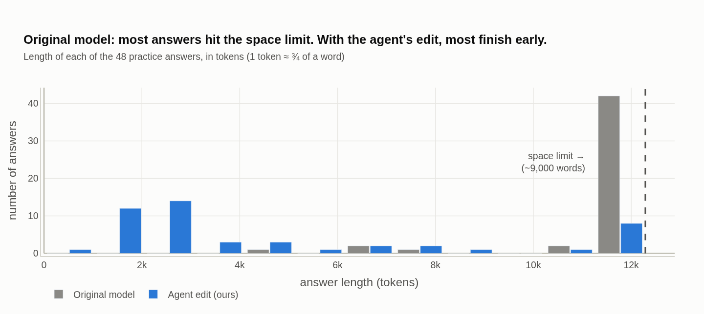

**Figura 1:** Comprimento de cada uma das 48 respostas de prática. A maioria das respostas do modelo original bate no
limite de espaço; com a edição do agente, a maioria termina cedo.

Mudar o prompt não ajuda. Um prompt de sistema pedindo que o modelo não se repita não faz melhor do que um prompt
placebo sem sentido. Os dois chegam a *aumentar* um pouco a taxa de loop (31% e 30%, contra 23% sem prompt). O loop
está nos hábitos do modelo, não nas instruções.

## As regras do jogo

**Configuração**
- **Modelo:** Qwen3.5-0.8B (Qwen Team, 2026), na mesma revisão do estudo original, rodando no llama.cpp
  (Gerganov et al., 2023).
- **Tarefa:** matemática do ensino fundamental (GSM8K; Cobbe et al., 2021), com raciocínio ligado e orçamento de 12.288 tokens.
- **Edições permitidas:** no máximo 4. Cada edição escolhe um grupo de "neurônios" (colunas de uma matriz de saída em
  uma camada), uma direção no espaço interno do modelo e uma intensidade. Ela muda apenas o quanto esses neurônios
  escrevem naquela direção:

  $$w_j \leftarrow w_j - \alpha\,(u^\top w_j)\,u, \qquad |\alpha| \le 10.$$

  Em palavras: $\alpha = 1$ apaga essa parte do que os neurônios escrevem, $\alpha > 1$ inverte e $\alpha < 0$
  reforça. Cada edição é uma mudança de posto 1.
- **Os agentes recebem:** os pesos, um briefing escrito que descreve o defeito (os loops, com um exemplo) e um avaliador com orçamento fixo. O avaliador oferece 40
  "notas rápidas", que medem o quanto o modelo *quer* se repetir sem deixá-lo escrever. Também oferece 6 "testes
  reais", em que o modelo editado de fato resolve 16 problemas de prática.
- **Não é permitido:** treinar, rodar o modelo fora do avaliador, editar as camadas de vocabulário, nem ler a edição
  do estudo original, as nossas anotações, o trabalho de outros agentes ou o código do avaliador. Essas regras não
  foram impostas por software: auditamos depois cada ação no registro de cada agente e não encontramos violações.
- **Agentes:** Claude Opus 5.5, um por execução, cerca de 2 horas cada. Algumas execuções também receberam um
  **atlas**: um mapeamento detalhado da atividade interna do modelo enquanto ele entra em loop.
- **Como julgamos:**
  - **Conjunto de prática:** confirmamos a escolha de cada agente em outros 48 problemas (dev48).
  - **Segundo conjunto de prática:** 32 problemas de teste. Já os tínhamos usado em rodadas exploratórias, então não
    são um teste lacrado.
  - **Teste trancado:** 200 problemas de teste, abertos uma única vez, depois de anotarmos as previsões. Três braços
    entraram depois e estão marcados.
  - **Matemática mais difícil:** medimos a transferência para 148 problemas de competição (MATH-500; Hendrycks et al., 2021; Lightman et al.,
    2024) que nenhuma busca
    tocou.
- **Comparações justas:** todo método responde aos mesmos problemas com as mesmas sementes aleatórias, então dá para
  contar, problema por problema, quem resolveu o quê.

## Um agente consegue corrigir os loops editando pesos?

*Experimento 1*

### Conseguimos reproduzir a edição publicada?

A edição publicada muda só duas matrizes, nas camadas 15 e 19. Nós a recuperamos com exatidão. Cada mudança é uma
única edição de posto 1 com intensidade 6: ela pega a parte da saída de 64 neurônios que está ao longo de uma "direção
de repetição" e a inverte, deixando-a em −5× o tamanho original. As duas camadas usam quase a mesma direção, escrita por
neurônios diferentes.

**Na nossa montagem, a edição publicada leva o conjunto de prática de 15% para 46%, e a matemática mais difícil de 8%
para 21%.** Nossos números absolutos no MATH são menores que os do artigo porque o nosso orçamento de tokens é 12k, e
não 32k. Todos os métodos aqui usam o mesmo orçamento. Isso pesa mais para a edição publicada do que para as outras:
ela ainda está melhorando quando bate nos 12k (veja o teste trancado abaixo).

*Experimento 2*

### Um agente Claude consegue encontrar a própria correção?

Nosso primeiro agente (a0) só tinha as notas rápidas. Ele encontrou uma edição diferente, que desencoraja o modelo de
copiar "Yes", "?" e "Wait" em duas camadas de atenção, e empatou com a edição publicada no segundo conjunto de prática
(44% contra 41%).

Depois acrescentamos os 6 testes reais. **Dois agentes, trabalhando de forma independente, editaram neurônios em comum
com a mesma receita em duas partes (suprimir "Wait", reforçar `</think>`), e ela é bem mais forte: 67% e 65% no
conjunto de prática.**

| agente | o que a edição faz (≤ 4 edições de posto 1) | conjunto de prática |
|------|----------------------------------------------|--------------|
| a1 | enfraquece a vontade de dizer "Wait" em 3 neurônios (L17n1915, L18n881, L22n573) e reforça o sinal de `</think>` na última camada | **67%** (26 resgatados, 1 perdido) |
| a2 | inverte o que 4 neurônios escrevem na direção de "Wait" (L16n998, L16n3422 e os L17n1915 e L22n573 do a1) e reforça `</think>` na camada 22 | **65%** (24 resgatados, 0 perdidos) |

**Qual edição do a1 relatamos.** O agente a1 ordenou duas variantes da mesma edição: os mesmos neurônios, com
intensidades −9 e −1,1 (a primeira escolha dele) ou −6 e −0,8 (a segunda). Levamos a variante mais branda, a segunda
da lista, a todas as comparações, porque ela foi melhor no conjunto de prática (67% contra 65%). Essa escolha foi
nossa, não do agente. No teste trancado as duas são indistinguíveis (61,5% contra 62,0%), e a primeira escolha do
agente escreve menos da metade dos tokens. Daqui em diante, "a1" é a variante mais branda, salvo aviso.

**Como funciona:** os dois agentes leram os pesos "através do vocabulário". Para cada neurônio, perguntaram que
palavra ele empurra o modelo a dizer. Foi assim que acharam neurônios que empurram "Wait". As anotações deles mostram
que aprenderam com os próprios erros. Negar esses neurônios por completo fez o modelo dizer "wait wait wait…" e não
resolver nada, o que lhes mostrou que esses neurônios funcionam ao contrário do que tinham suposto.

As duas partes só funcionam juntas. Nas nossas ablações, cada uma um teste real com 16 problemas:
- o reforço de `</think>` sozinho resolve 19%;
- a supressão de "Wait" sozinha resolve 44–50%;
- as duas juntas resolvem 69%, e quase nada fica sem espaço.

Um loop precisa de um caminho de volta ("Espera, deixa eu conferir") e de nenhuma saída. A edição fecha o primeiro e
abre a segunda.

**Neurônios em comum, alavancas diferentes.** A a1 e a a2 têm dois neurônios em comum e a mesma direção de "Wait", mas a a1
torna a escrita deles 7× mais forte e a a2 a inverte para −9×. Conferimos o que esses neurônios fazem em 12 textos em
loop do modelo original:
- **A a1 reforça um freio.** O neurônio L22n573 tem ativação negativa em todas as posições logo antes de um "Wait"
  (52 de 52), e os pesos de saída dele apontam para "Wait". Ele empurra, portanto, *contra* a palavra, e a a1 amplia
  esse empurrão. Com o texto fixo, os três neurônios da a1 baixam a log-probabilidade de "Wait" nessas posições em
  16,6 nats, e a edição da última camada, sozinha, sobe a de `</think>` em 1,5 nat. As duas partes são separáveis. O
  L18n881 quase não contribui.
- **A a2 age por um único neurônio a montante.** Ela também baixa "Wait" ali (em 26 nats), e editar só o L16n998
  dá o efeito inteiro (−26,2 nats). No modelo original esse neurônio promove "Wait"; depois da edição, ele o suprime.
  As outras três edições de neurônio quase não mudam nada: L16n3422 e L17n1915 movem "Wait" em menos de 0,3 nat, e
  a inversão do L22n573, sozinha, *sobe* a palavra em 1,6.
- **Com a edição da camada 16 da a2, o freio se cala.** Dentro do modelo editado pela a2 (e com só os seus dois
  neurônios da camada 16 editados), a ativação do L22n573 antes de um "Wait" cai de −3,73 para −0,04, e a inversão desse neurônio pela a2 fica quase sem ter sobre o que agir. O freio
  parece responder a um empurrão a montante na direção de "Wait"; sem o empurrão, ele para de disparar.

Os dois agentes intervêm, então, no mesmo circuito em pontos diferentes: a a1 reforça o freio na camada 22, e a a2
tira o empurrão na camada 16. Essas medidas eram log-probabilidades com o texto fixo, então as conferimos com testes
reais nos 48 problemas de prática (com as previsões registradas antes):
- **A a2 funciona como uma correção de 2 edições.** Mantendo só o L16n998 e a edição de `</think>`, o modelo resolve
  69% (33 de 48), contra 65% da a2 inteira (6 resgatados, 4 perdidos, p = 0,75), com respostas mais longas
  (4.797 tokens contra 3.910; 6 cortadas contra 4). Os outros três neurônios (L16n3422, L17n1915, L22n573) não
  fizeram diferença mensurável em 48 problemas. No segundo teste trancado, a versão de 2 edições resolve 67,5%,
  contra 64,0% da a2 inteira (28 resgatados, 21 perdidos; p = 0,39), e na matemática mais difícil, 47,3% contra
  48,6% (12 resgatados, 14 perdidos).
- **Baixar "Wait" não basta para parar.** Só o L16n998, que dava os 26 nats inteiros com o texto fixo, resolve 48%
  (23 de 48), e 25 de 48 respostas estouram o espaço. Contra a versão de 2 edições, resgata 3 e perde 13 (p = 0,02).
  Isso bate com as ablações da a1 acima: num loop, as duas portas precisam mudar.

A Figura 2 descreve a a1.

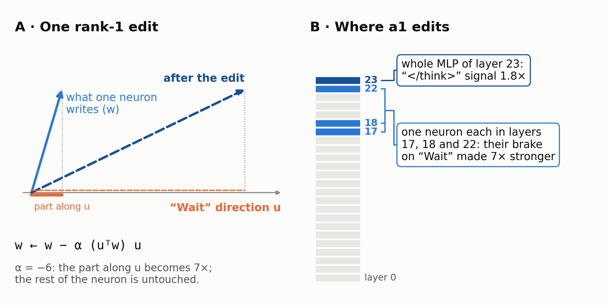

**Figura 2:** Anatomia da edição a1. (A) Uma edição de posto 1 muda só a parte do que um neurônio escreve numa
direção escolhida. (B) A a1 reforça o freio de três neurônios sobre “Wait” e o sinal de `</think>` na última camada.

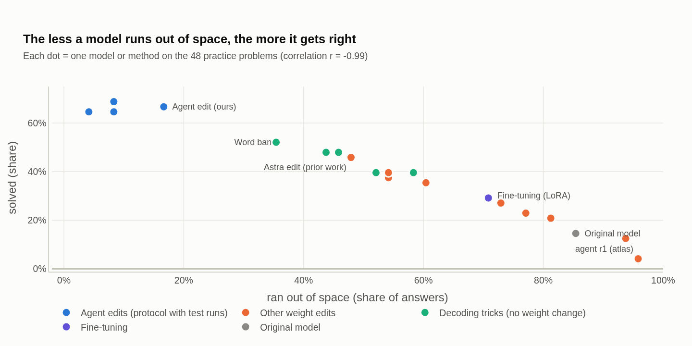

**Figura 3:** Em 25 modelos e métodos que rodamos no conjunto de prática (sem as execuções exploratórias do Fable), quanto menos respostas ficam sem espaço, mais respostas estão
certas (r = −0,98).

*Experimento 3*

### A correção se mantém em problemas que o agente nunca viu?

**Na matemática de competição, que nunca foi usada em nenhuma busca, a edição resolve 47%, contra 21% da edição
publicada no mesmo orçamento de 12k.** Comparada problema por problema com a edição publicada, ela resgatou 44
problemas e perdeu 6. A edição do segundo agente, rodada depois nos mesmos problemas, resolve 49% (43 resgatados e
2 perdidos contra a edição publicada; 18 e 15 contra a a1). No segundo conjunto de prática, a a1 resolve 56% (o
original: 13%; a edição publicada: 41%).

Duas ressalvas sobre os números do MATH. Primeiro, a edição publicada ainda fica sem espaço em 78% desses problemas,
então os 21% dela são limitados pelo nosso orçamento (o estudo original relata 48% com 32k). Segundo, o nosso corretor
de respostas é rígido e deixa passar algumas formas equivalentes. Corrigir os falsos negativos que achamos sobe um
pouco todos os métodos e mantém a ordem (a1 49%, a1 + limite de raciocínio 55%, limite de raciocínio 38%, edição
publicada 22%). As tabelas usam os números sem correção.

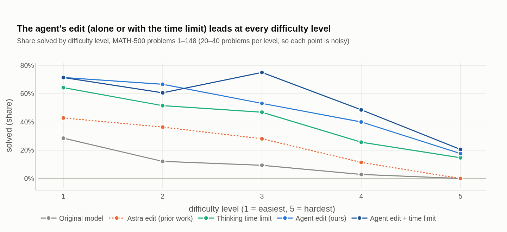

**Figura 4:** A edição do agente (sozinha ou com o limite de tempo de raciocínio) fica à frente em todos os níveis de
dificuldade.

**O teste trancado.** Abrimos 200 problemas lacrados uma única vez, depois de anotar as previsões. No orçamento cheio
de 12.288 tokens, a a1 resolve 61,5% (o original: 15,5%; a edição publicada: 53,5%). Problema por problema, ela vence
a edição publicada por **8,0 ± 3,4 pontos** (32 resgates, 16 perdas; p = 0,03, sem correção).

**Mas é o orçamento que decide essa comparação.** A tabela mostra a parcela resolvida se cortarmos toda resposta num
orçamento menor. Os braços marcados com † rodaram depois de o teste ter sido aberto.

| método | 2.048 | 4.096 | 6.144 | 8.192 | 12.288 | cortadas em 12k | tokens (média) |
|---|---|---|---|---|---|---|---|
| modelo original | 3,5% | 6,5% | 10,5% | 12,0% | 15,5% | 84,5% | 11.142 |
| edição publicada (Astra) | 10,0% | 19,0% | 24,5% | 39,0% | 53,5% | 42,5% | 8.877 |
| fine-tuning (LoRA) † | 12,5% | 20,5% | 26,0% | 30,0% | 33,0% | 65,5% | 9.354 |
| proibir a palavra "Wait" † | 10,0% | 26,5% | 41,5% | 50,5% | 60,0% | 35,5% | 7.758 |
| limite de raciocínio, 4.096 | 4,0% | 6,5% | 60,5% | 60,5% | 61,0% | 34,0% | 7.012 |
| limite, resposta com teto de 1.024 † | 2,5% | 5,0% | 60,0% | 60,0% | 60,0% | 35,0% ‡ | 4.596 |
| edição do agente (a1) | 29,0% | 45,0% | 55,5% | 60,5% | 61,5% | 17,0% | 5.049 |
| primeira escolha do agente a1 † | 46,5% | 60,0% | 61,5% | 62,0% | 62,0% | 5,5% | 2.269 |
| edição do segundo agente (a2) † | 37,5% | 53,0% | 63,5% | 66,5% | 67,5% | 15,5% | 4.387 |
| a1 + limite de raciocínio | 25,0% | 49,0% | 67,5% | 69,0% | 69,5% | 9,5% | 4.081 |
| a1 + limite, resposta com teto † | 25,5% | 54,5% | 69,5% | 69,5% | 69,5% | 15,0% ‡ | 3.172 |
| modelo original, raciocínio desligado † | — | — | — | — | 58,5% | 5,0% | 1.263 |

‡ Com teto para a resposta, esta coluna conta as respostas interrompidas por esse teto.

- **A edição publicada ainda não estabilizou.** Ela ganha 14,5 pontos entre 8k e 12k, e 42,5% das respostas dela
  ainda estão em andamento no teto. Com um orçamento maior, ela provavelmente fecharia parte ou toda a diferença de 8
  pontos. Não rodamos isso.
- **As edições dos agentes estabilizam cedo.** A primeira escolha do agente já está em 60% com 4.096 tokens, onde a
  edição publicada está em 19%. O que os dados sustentam é eficiência: mais ou menos o mesmo acerto com um terço a um
  quarto dos tokens.
- **A a2 é a melhor edição isolada (67,5%).** Ela vence a edição publicada por 14,0 ± 3,6 pontos (42 resgates, 14
  perdas). A vantagem sobre a a1 é de 6 pontos (29 resgates, 17 perdas; p = 0,10), e 15,5% das respostas dela ainda
  são cortadas.
- **Desligar o raciocínio é a correção mais barata neste benchmark.** O modelo original, assim, resolve 58,5% com
  cerca de 1.300 tokens por resposta. A a1 com raciocínio fica 3,0 ± 3,5 pontos acima (p = 0,48): empate. A a2 fica
  9,0 ± 3,5 acima (p = 0,02), e a a1 com limite de raciocínio, 11,0 ± 3,5 acima (p = 0,003). Com o raciocínio
  desligado, as edições não ajudam nem atrapalham (a1 56,0%, edição publicada 57,5%).

Todos os valores de p são testes do sinal exatos sobre os pares discordantes, sem correção para múltiplas comparações.
Com a correção de Holm sobre as comparações desta seção, a1 contra a edição publicada deixa de ser significativa; a2
contra a edição publicada e a1 + limite contra o raciocínio desligado continuam sendo.

### Um segundo teste trancado, todo pré-registrado

No primeiro teste trancado, oito braços rodaram depois da abertura. Por isso abrimos mais 200 problemas trancados
(GSM8K test[400:600]) com todos os braços, as comparações e as previsões registrados antes, e nada escolhido neles. A
análise primária eram cinco comparações pareadas com correção de Holm; a secundária somava os dois testes trancados.

| método | segundo teste trancado (200) | cortadas | média de tokens | os dois testes (400) |
|---|---|---|---|---|
| modelo original, raciocínio desligado | 58,0% | 7,5% | 1.365 | 58,3% |
| limite, resposta limitada a 1.024 | 59,5% | 34,5% ‡ | 4.620 | 59,8% |
| edição do segundo agente (a2) | 64,0% | 15,5% | 4.701 | 65,8% |
| a1 + limite, resposta limitada | 64,5% | 15,5% ‡ | 3.104 | 67,0% |
| a2 reduzida a 2 edições | 67,5% | 12,0% | 4.217 | — |
| edição do agente (a1) | 68,0% | 11,0% | 4.459 | 64,8% |

‡ Conta as respostas paradas pelo teto da resposta.

- **Sozinho, o segundo teste não confirma nenhuma das cinco comparações primárias.** Todos os braços editados ficam à
  frente do raciocínio desligado na direção prevista (a2 +6,0 ± 4,0, a1 + limite com teto +6,5 ± 4,3), mas nenhuma
  comparação sobrevive à correção (todos os p ajustados por Holm = 0,83). Duzentos problemas não confirmam diferenças
  de 5–7 pontos. Três das nossas previsões falharam aqui (veja a lista no fim), e a a2 ficou 4,0 pontos atrás da a1
  (p = 0,30) depois de estar 6 à frente no primeiro teste.
- **Somando os 400 problemas trancados, as edições ficam acima do raciocínio desligado.** A a2 fica 7,5 ± 2,7 pontos
  acima (74 resgates, 44 perdas; p = 0,007), a a1 + limite com teto 8,8 ± 2,8 (p = 0,002) e a a1 6,5 ± 2,7 (p = 0,02,
  não pré-registrada). As duas primeiras eram as comparações secundárias pré-registradas; nenhuma tem correção para
  comparações múltiplas. O raciocínio desligado continua usando só 28–42% dos tokens delas.
- **As edições também ficam à frente do limite de raciocínio.** Nos 400 problemas, a a1 + limite com teto fica
  7,2 ± 2,4 pontos acima do limite com teto sozinho (p = 0,004, secundária pré-registrada), e a a1 e a a2 ficam 5,0 e
  6,0 pontos acima dele (p = 0,047 e 0,02, não pré-registradas). O empate do primeiro teste agora parece a ponta baixa
  da faixa.
- **Somar o limite à a1 não ajudou aqui.** A combinação resolveu 64,5% contra 68,0% da a1 sozinha (17 resgates, 24
  perdas). Nos dois testes juntos, fica 2,2 ± 2,2 pontos acima da a1 (p = 0,36): não está estabelecido em matemática
  do ensino fundamental. A a1 foi baixa fora do comum no primeiro teste (61,5%) e alta no segundo (68,0%).

### Uma checagem rápida com outro modelo editor

*Checagem exploratória, rodada depois de o teste trancado ter sido aberto. Não é comparável com a1 e a2.*

Também rodamos o protocolo vencedor com dois agentes no Claude Fable 5.2 (f1, f2), para ver se outro modelo editor
acharia algo diferente. As condições não foram as mesmas de a1 e a2: o prompt tinha regras a mais (sem acesso à web,
sem ler o repositório deste paper, sem subagentes), as execuções foram pausadas e retomadas, e estendemos o orçamento
delas depois de ver os primeiros resultados. As duas acharam os neurônios de "Wait" que a1 e a2 editaram, não os
mantiveram e terminaram com edições de camada inteira na direção de "Wait" nas últimas camadas, mais parecidas na
forma com a edição publicada do que com a a1. Resolveram 65% e 60% do conjunto de prática, e a escolha da f1 resolveu
66,0% no teste trancado. Isso mostra só que outro modelo editor também consegue consertar o defeito, por outro
caminho. Não diz qual editor é melhor; para isso serve a escada de modelos editores planejada como continuação, com
várias execuções por modelo sob um só protocolo.

## É só um truque?

Um cético perguntaria se a edição é só um jeito sofisticado de fazer algo mais simples. Testamos as alternativas mais
simples, ajustadas em 48 problemas (três vezes o que os agentes viram), o que as favorece.

| método | prática (48) | segundo conjunto de prática (32) | teste trancado (200) | matemática difícil (148) |
|--------------------------------|-----------|-----------|-----------|-----------|
| modelo original | 15% | 13% | 15,5% | 8% |
| modelo original, raciocínio desligado | — | — | 58,5% † | 44% |
| edição publicada (Astra) | 46% | 41% | 53,5% | 21% |
| proibir a palavra "Wait" (melhor de 3 ajustes) | 52% | 47% | 60,0% † | 27% (primeiros 48) |
| limite de raciocínio, 4.096 tokens (melhor de 2) | 48% | **63%** | 61,0% | 37% |
| limite, resposta com teto de 1.024 (melhor de 3) | 50% | — | 60,0% † | — |
| edição por diferença de médias, sem agente (melhor de 6) | — | 31% | — | — |
| busca por script, sem agente | 27% | — | — | — |
| fine-tuning (LoRA) | 29% | — | 33,0% † | — |
| **edição do agente (a1)** | **67%** | 56% | 61,5% | **47%** |
| primeira escolha do agente a1 | 65% | — | 62,0% † | — |
| edição do segundo agente (a2) | 65% | — | 67,5% † | 49% |
| **edição do agente + limite de raciocínio** | **69%** | **63%** | **69,5%** | **53%** |

† Rodado depois de o teste trancado ter sido aberto; nenhuma escolha dependeu desses braços.

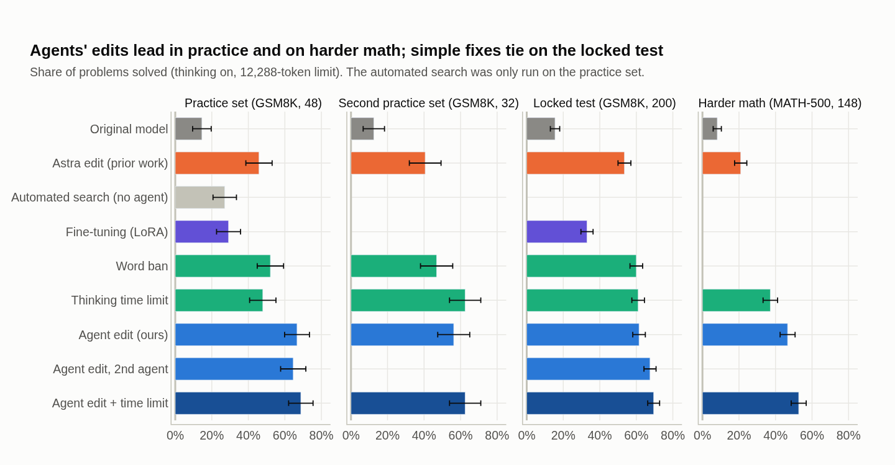

**Figura 5:** Parcela de problemas resolvidos por cada método nos quatro conjuntos de problemas (barras de erro: ±1 erro
padrão).

*Experimento 4*

### Um ajuste de decodificação faria o mesmo?

**Configuração**
- **Proibir a palavra:** enquanto o modelo escreve, tornar "Wait" (e variantes) quase impossível e dar um empurrão em
  `</think>`. Nenhuma mudança nos pesos.
- **Limite de raciocínio ("budget forcing", Muennighoff et al., 2025):** depois de N tokens de raciocínio, cortar e forçar uma resposta.
  Nenhuma mudança nos pesos.

**Proibir a palavra é pior nos conjuntos de prática e na matemática mais difícil, e empata no teste trancado.** Ali
ela resolve 60,0%, contra 61,5% da a1 (25 resgates contra 28), com 7.758 tokens por resposta e 35,5% das respostas
cortadas. Tínhamos previsto 40–52%. A edição não é uma proibição global. Ela age por
meio de neurônios que estão ativos quando o modelo está prestes a recomeçar, então deixa "Wait" em paz no resto.

**O limite de raciocínio empata com a edição no primeiro teste trancado (61,0% contra 61,5%; +0,5 ± 3,4), mas não
no segundo** (a1 68,0% contra 59,5% da versão do limite com teto; 33 resgates, 16 perdas; p = 0,02, não
pré-registrada). A nossa
implementação do limite parece mais cara do que é. Depois do `</think>` forçado, algumas respostas continuam em loop
até o teto de 12k, e por isso 34% delas são cortadas e a média é de 7.012 tokens. Se cortarmos toda resposta em 6.144
tokens, o limite mantém 60,5% com média de 4.910 tokens, mais ou menos o mesmo que a a1 (5.049). Não afirmamos,
portanto, que a edição é mais barata do que um limite bem implementado. Depois rodamos essa versão, com a resposta
limitada a 1.024 tokens depois do `</think>` forçado (limite de raciocínio escolhido entre três no conjunto de
prática). Ela resolve 60,0% com média de 4.596 tokens, o mesmo acerto do limite sem teto (14 resgates contra 16).

Na matemática mais difícil, a edição fica 9,5 pontos à frente do limite, resgatando 23 problemas e perdendo 9. Forçar
uma resposta cedo funciona quando a resposta já tinha sido calculada antes de o loop começar, o que é comum em
problemas do ensino fundamental e mais raro nos longos.

**Juntos, os dois são o melhor na matemática mais difícil (53%, 6 pontos acima da edição sozinha, embora com só 16
resgates contra 7; p = 0,09) e no primeiro
teste trancado (69,5%, 8 pontos acima de cada um sozinho), com poucas respostas cortadas.** A edição tira a maior
parte dos loops, e o limite pega o que sobra. No segundo teste trancado, porém, a combinação não superou a a1 sozinha
(64,5% contra 68,0%), então, em matemática do ensino fundamental, o ganho sobre a edição não está estabelecido
(+2,2 ± 2,2 nos 400 problemas).
Uma replicação independente relata a mesma soma em subconjuntos do MATH (tdotlab, 2026). Com o teto para a resposta,
a combinação mantém 69,5% no primeiro teste trancado e cai para 3.172 tokens por resposta. Ali, ela fica acima da a1
sozinha (26 resgates, 10 perdas; p = 0,01), do limite com teto sozinho (33 contra 14; p = 0,008) e do raciocínio desligado (37
contra 15; p = 0,003).

**Raciocínio desligado.** No nosso subconjunto do MATH, com o raciocínio desligado e teto de 8.192 tokens, o modelo
original resolve 43,9% (previsto: 38–52%) com 3.842 tokens por resposta, e 36% das respostas ainda batem no teto. A
a1 (46,6%) e a a2 (48,6%) ficam 2,7 e 4,7 pontos acima (21 resgates contra 17, p = 0,63; 21 contra 14, p = 0,31):
empates. Só a a1 + limite (52,7%) fica acima (23 resgates, 10 perdas; p = 0,035, sem correção). Aqui, desligar o
raciocínio economiza menos do que na matemática do ensino fundamental: usa cerca de metade dos tokens da a1, não um
terço. Reexecuções independentes relatam cerca de 50% no MATH-500 inteiro com o raciocínio desligado e orçamento de
32k (exp8-loop-controls, 2026). Neste modelo, edições que consertam o raciocínio recuperam, em boa parte, o que o
modelo já faz sem raciocinar, mais alguns pontos: nos 400 problemas trancados, os braços editados ficam 6,5–8,8
pontos acima do raciocínio desligado, com 2,4–3,6× os tokens dele; na matemática mais difícil, só a combinação com
o limite fica acima (p = 0,035, sem correção).

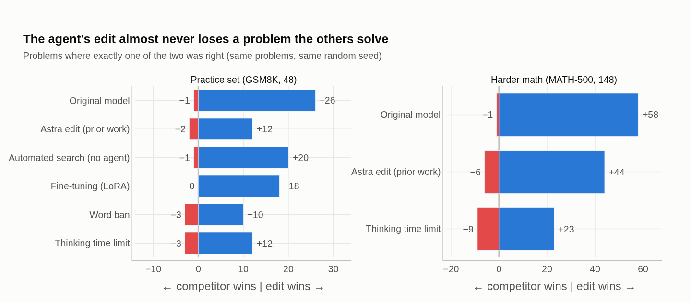

**Figura 6:** Problema por problema, com os mesmos problemas e sementes: problemas que só a edição do agente resolveu
(direita) contra problemas que só o outro método resolveu (esquerda).

*Experimento 5*

### Um fine-tuning comum faria o mesmo?

**Configuração**
- **Dados:** o raciocínio do próprio modelo em 600 *outros* problemas do GSM8K. Só 57 tentativas terminaram de forma
  limpa e correta. Em 279 que entraram em loop, cortamos o raciocínio onde o loop começou, fechamos o raciocínio e
  deixamos o modelo responder: 118 respostas estavam certas. Isso dá 175 exemplos de treino.
- **Treinamento:** LoRA (Hu et al., 2022), um método de fine-tuning padrão e barato (posto 16, todas as camadas, 3 rodadas).
  Escolhemos a melhor rodada nos mesmos 16 problemas que os agentes usaram nos testes reais.

**O fine-tuning chegou a 29% no conjunto de prática. É melhor que o original (15%), mas, problema por problema, a
edição do agente resgatou 18 problemas que o fine-tuning errou e não perdeu nenhum.** O modelo com fine-tuning ainda
ficou sem espaço em 71% das respostas (a edição: 17%). Ele aprendeu o que escrever *depois* de um corte, não *quando*
parar. Esta é uma receita barata, com 175 exemplos, e não a ajustamos além disso. Mais dados, uma receita de dados
melhor ou aprendizado por reforço poderiam fazer melhor, com mais tempo de GPU (veja abaixo). O resultado é "esta
receita de fine-tuning perdeu", não "o fine-tuning perde".

No teste trancado, o modelo com fine-tuning resolve 33,0% e ainda fica sem espaço em 65,5% das respostas. A a1
resgata 69 problemas que ele erra e perde 12.

*Experimento 6*

### O agente é necessário, ou bastam as ferramentas dele?

Escrevemos um script que testa edições da mesma caixa de ferramentas que os agentes vencedores usaram: "direções de
palavras" para as 300 palavras mais comuns, os neurônios mais alinhados a elas e intensidades aleatórias. Ele teve o
mesmo orçamento: 40 notas rápidas e mais 6 testes reais com os candidatos mais promissores.

**O melhor teste real do script resolveu 3 de 16, e a escolha dele chegou a 27% no conjunto de prática, 40 pontos
abaixo dos agentes.** Com essa caixa de ferramentas e esse orçamento, escolhas ao acaso não bastaram.

Esta é uma comparação fraca, e existem buscas sem LLM mais fortes:
- **As nossas edições por diferença de médias.** Montamos seis edições a partir da diferença entre o estado interno
  médio do modelo em textos com e sem loop, sem agente. A melhor resolveu 31% do segundo conjunto de prática, contra
  41% da edição publicada e 13% do original: cerca de dois terços do ganho da edição publicada.
- **Trabalhos concorrentes.** Uma direção de diferença de médias recupera 79% do ganho da edição publicada no MATH-500
  (Zhang, 2026), e um programa linear chega a cerca de 93% (nathanrs, 2026). Um reparo às cegas, com um modelo editor
  mais fraco e sem descrição do defeito, não achou nada (WKJBryan, 2026).

Não afirmamos, então, que um agente é necessário. A nossa evidência é mais estreita: os dois agentes superaram todas
as buscas sem agente que *nós* rodamos, e o nosso briefing dizia a eles qual era o defeito.

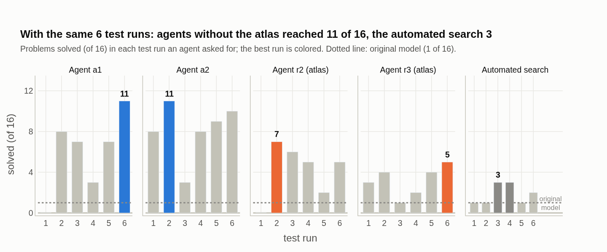

**Figura 7:** Os 6 testes reais de cada buscador (16 problemas cada). Os dois agentes sem o atlas chegaram a 11 de 16;
os agentes com o atlas, a 5–7; o script, a 3.

## O que aprendemos sobre o processo

*Experimento 7*

### Uma nota rápida pode substituir os testes reais?

Testes reais são lentos (16 problemas levam cerca de 10 minutos na nossa GPU), então a saída óbvia é um indicador
rápido. Todo indicador que tentamos quebrou assim que um otimizador forte o pressionou:
- uma edição que pontuou melhor do que a edição publicada na "surpresa" do modelo com palavras de loop ganhou 6 pontos
  no uso real, contra 28 da edição publicada;
- uma edição sem nenhum loop palavra por palavra ainda ficou sem espaço em 77% das vezes;
- **o agente r1 levou a nota rápida a 20× o valor da edição publicada, e a edição dele resolveu 4% dos problemas, pior
  do que não fazer nada.** Ela bloqueou a cópia palavra por palavra, e o modelo simplesmente entrou em loop de outras
  formas (valores alternados, listas crescentes).

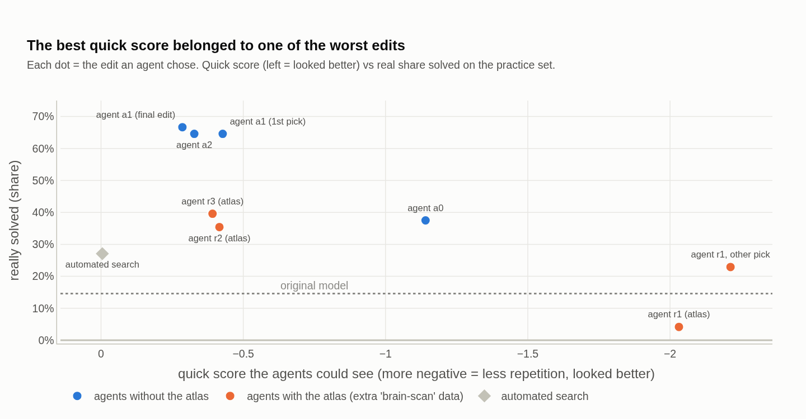

**Figura 8:** A nota rápida que a edição escolhida por cada agente obteve (à esquerda = parecia melhor) contra o quanto
ela de fato resolveu problemas.

Seis testes reais resolveram isso. Nesse protocolo, as primeiras ideias de melhor nota dos dois agentes resolveram 0 de
16 num teste real, e os agentes as descartaram. **Nossa conclusão: o objetivo de um agente precisa vir do comportamento
real, mesmo de uma amostra pequena dele. Indicadores servem como proteção, não como meta.**

*Experimento 8*

### Mais dados de interpretabilidade ajudam?

Rodamos três pares de agentes com instruções idênticas; em cada par, um dos agentes também tinha o atlas.

**Nos três pares, o agente sem o atlas encontrou a edição melhor (38% contra 4%; 67% contra 35%; 65% contra 40%).**
Com o atlas, os agentes perseguiram mecanismos internos elaborados, como um estado de "reconferência" nas camadas do
meio e "cabeças de loop". Pareciam convincentes nos dados, mas não paravam os loops. Sem ele, os agentes foram direto às
alavancas: a palavra "Wait" e o sinal de `</think>`. Três pares tornam isso sugestivo, não comprovado. O primeiro par
também rodou no protocolo antigo, sem testes reais, e nos dois primeiros pares tínhamos previsto o resultado oposto.

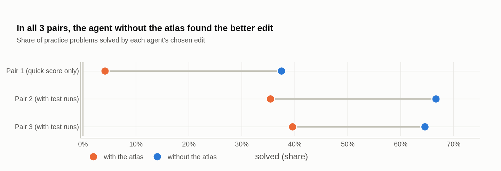

**Figura 9:** Cada par de agentes teve instruções idênticas; o agente sem o atlas foi melhor todas as vezes.

## Quanto custou?

| | prática | horas de GPU (1660 SUPER) | uso do agente |
|---------------------|---------|----------|-------------------------------|
| **edição do agente (uma execução)** | **67%** | **1,3** (só a busca) | 5,4 M tokens lidos, 48 mil escritos (≈ US$ 5–7 a preço de API) |
| busca automática | 27% | 1,6 | — |
| ajuste dos truques de decodificação | 48–52% | 4,4 | — |
| fine-tuning (LoRA) | 29% | 17,1 | — |

- **Custo único.** Uma execução de agente levou cerca de 2 horas, o que dá mais ou menos a energia de um micro-ondas
  ligado por 15 minutos. O fine-tuning levou 17 horas de GPU, 10 delas só para gerar os dados de treino com um modelo
  que desperdiça a maior parte das tentativas.
- **Custo de uso.** Contra o modelo original com raciocínio, as respostas do modelo editado são 60% mais curtas no
  conjunto de prática, 55% no teste trancado e 29% na matemática mais difícil. A primeira escolha do agente a1 é 80%
  mais curta no teste trancado, e a a1 com o limite com teto é 72% mais curta. Essa economia se repete em cada
  pergunta. Ela só vale contra o raciocínio ligado: com
  o raciocínio desligado, o modelo original escreve cerca de 1.300 tokens por resposta, menos que qualquer edição.
- **Comparação com o agente original.** A execução publicada usou 86,8 M tokens lidos e 2,9 M escritos ao longo de 20
  horas (segundo os registros públicos). Nosso agente usou 16× e 60× menos, em cerca de 2 horas. As ferramentas são
  diferentes, então esta não é uma comparação controlada.
- **O que a tabela deixa de fora.** As horas de GPU são só as da busca. Confirmar uma escolha no conjunto de prática
  custa cerca de 1 hora de GPU a mais, para qualquer método. A linha do agente é uma execução que deu certo; fizemos
  seis execuções ao todo, e as três com o atlas foram piores.
- **As letras miúdas.** Rodamos com uma assinatura, então os valores em dólar são estimativas a preço de tabela. Numa
  GPU alugada muito barata, o fine-tuning poderia custar alguns dólares a menos que o uso do agente, entregando menos
  da metade da melhoria.

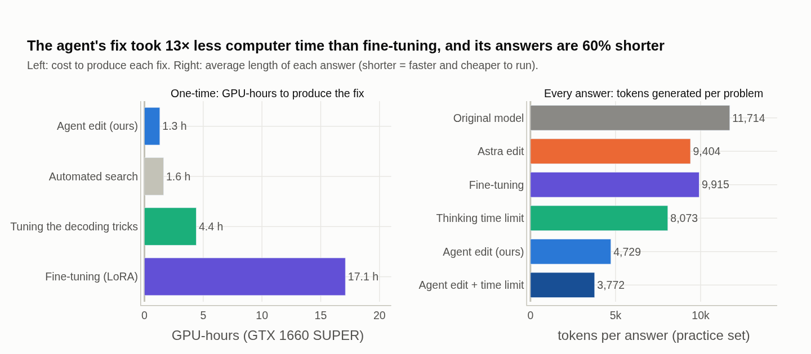

**Figura 10:** À esquerda, horas de GPU para produzir cada correção. À direita, o comprimento médio das respostas, que
define o custo de cada resposta futura.

## A cirurgia quebrou alguma coisa?

Com o raciocínio desligado, nenhuma das edições muda o acerto em matemática (200 problemas) ou em chamada de
ferramentas (300 pedidos) além de cerca de dois erros padrão. A edição age onde os loops acontecem, durante o
raciocínio, e deixa as outras habilidades em paz. Há um efeito colateral positivo: com o raciocínio ligado, a edição
publicada fica melhor em recusar chamadas de ferramenta irrelevantes (16 de 16 contra 11 de 16), provavelmente porque um
raciocínio mais curto deixa menos espaço para inventar uma chamada.

**Um custo possível: as respostas que terminam erram mais.** No teste trancado, 74% das respostas terminadas da a1
estão certas, contra 91% da edição publicada, 92% do limite de raciocínio e 97% do modelo original. Na primeira
escolha do agente a1, a edição mais forte, são 66%; na a2, 80%. Parte disso é seleção: o modelo original só termina 31
dos 200 problemas, os fáceis, e as edições terminam também os difíceis. Mas a ordem (quanto mais forte o empurrão de
`</think>`, menor o acerto entre as terminadas) sugere que as edições também fazem o modelo concluir antes da hora.
Não separamos as duas coisas.

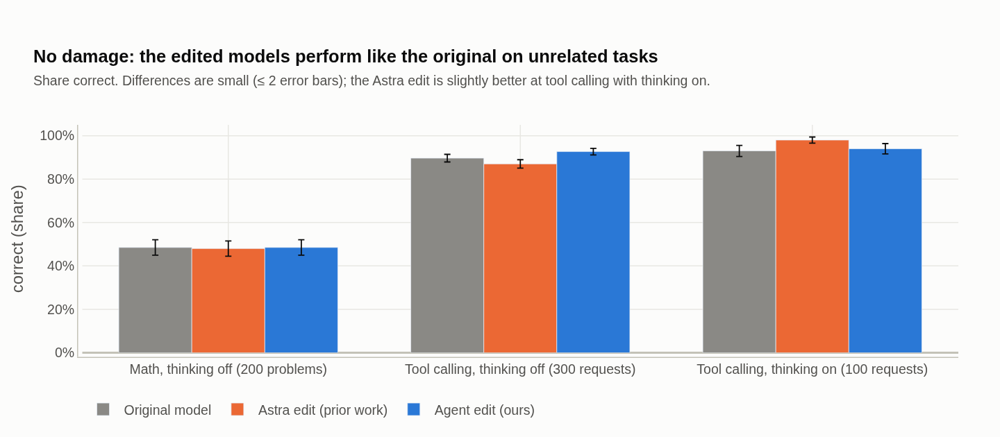

**Figura 11:** Acerto em tarefas não relacionadas para o modelo original, a edição publicada e a edição do agente.

## Funciona num segundo defeito?

**Não, e o jeito como falha é informativo.** Precisávamos de um defeito sem palavra-chave óbvia. JSON e chamadas de
ferramenta quebrados não eram um problema para este modelo com o raciocínio desligado: ele estava perto do teto.
Escolhemos então **seguir instruções** (IFEval, Zhou et al., 2023: "não use vírgulas", "tudo em minúsculas", "termine com esta frase
exata", "destaque pelo menos 3 seções"). Com o raciocínio desligado, o modelo segue todas as instruções em só cerca de
55% dos prompts, e as falhas se espalham por muitos tipos de instrução.

**Configuração**
- **Mesmo protocolo dos loops:** um agente com 40 notas rápidas e 6 testes reais por geração, no máximo 4 edições
  de posto 1.
- **Comparações:** um system prompt pedindo cuidado, e fine-tuning LoRA em 414 respostas do próprio modelo que
  passaram no verificador oficial (a mesma receita de antes).
- **Confirmação:** em 152–200 prompts do IFEval nunca usados em nenhuma busca.

| braço | mudança contra o original em prompts novos |
|---|---|
| agente, testes de 48 prompts (b1) | −3,3 ± 4,1 |
| a edição dos loops (a1), sem ajuste para isto | −3,9 ± 4,3 |
| system prompt | −6,6 ± 4,2 |
| fine-tuning (época escolhida em 48 prompts) | −7,2 ± 4,3 |
| agente, testes de 128 prompts (b2) | −6,0 ± 3,7 (200 prompts) |

**Todo método pareceu melhor no próprio teste de prática (+5 a +12 pontos) e perdeu em prompts novos.** A causa é o
ruído de amostragem. Duas execuções do modelo *sem mudança nenhuma*, com sementes diferentes, discordam em 23% dos
prompts. Em 48 prompts, isso dá uma margem de erro de 8–9 pontos, maior que qualquer ganho plausível. Um teste maior,
de 128 prompts, também não salvou o agente: o controle de sinal oposto da melhor edição também pareceu levemente
positivo.

**O que isso significa.** Nos loops, o efeito era de +46 pontos, e 16 problemas bastavam para vê-lo. Em seguir
instruções, mudanças baratas de qualquer tipo (pesos, prompt, gradiente) parecem tirar o modelo de um ponto que já é
quase o melhor da vizinhança, e nenhum teste desse tamanho acha as raras mudanças que ajudam. **O alcance do método é
dado pela razão sinal/ruído do teste real, não só pelo agente.** Uma receita barata de fine-tuning bate na mesma
parede. Nenhum braço aqui difere do original em mais de dois erros padrão, então o resultado é "nada ajudou", não
"tudo piorou". Um segundo teste do IFEval, lacrado, continua fechado.

**Isso não contradiz o ganho no IFEval relatado para a edição publicada** (de 21,0% para 62,3%; Takehi et al., 2026).
Esse número é com o raciocínio ligado, em que três quartos das respostas do modelo original nunca fecham o raciocínio e
valem zero: é o defeito dos loops de novo. Com o raciocínio desligado, uma reexecução independente mostra que a edição
publicada não ajuda (−2,3 pontos; exp8-loop-controls, 2026), o mesmo que vemos com a a1 (−3,9).

O agente da segunda execução também achou, só lendo os pesos, uma direção do fluxo residual que 99,7% das linhas dos
portões de esquecimento das 288 cabeças DeltaNet (Gated DeltaNet, Yang et al., 2025) leem com o mesmo sinal: um canal global de controle do esquecimento.
Editá-la muda o modelo, mas não muda o seguimento de instruções. Fica para trabalho futuro.

## Contexto e trabalhos relacionados

**Programação no espaço de pesos.** Takehi et al. (2026) mostraram que modelos de fronteira conseguem ler e escrever
pesos de redes neurais diretamente, incluindo a edição contra loops que reproduzimos. Usamos essa edição como
referência e os registros públicos deles na comparação de custo.

**Edição de modelos.** Edições de posto 1 já foram usadas para mudar fatos armazenados num modelo (ROME, Meng et al.,
2022; MEMIT, Meng et al., 2023). Apagar uma única direção pode remover um comportamento como a recusa (Arditi et al.,
2024). Nossas edições pertencem a essa família. A diferença é que um agente as escolhe raciocinando sobre o
comportamento, em vez de uma fórmula fixa.

**Direcionamento (steering).** Somar um vetor ao estado interno do modelo durante a execução pode direcionar o seu
comportamento (ActAdd, Turner et al., 2023; engenharia de representações, Zou et al., 2023). Nossas edições são
permanentes, em vez de aplicadas durante a execução.

**Raciocínio excessivo.** Modelos de raciocínio costumam reconferir mais do que precisam (Chen et al., 2025).
Correções conhecidas incluem suprimir palavras como "Wait" (Wang et al., 2025) e limitar o tempo de
raciocínio (Muennighoff et al., 2025). Usamos as duas como alternativas de comparação.

**Agentes e Goodhart.** Agentes já conduzem experimentos de interpretabilidade (MAIA, Rott Shaham et al., 2024).
Otimizadores fortes são conhecidos por burlar objetivos indiretos (Gao et al., 2023; Skalse et al., 2022). Vemos o mesmo
com indicadores derivados de interpretabilidade.

**Trabalhos concorrentes.** O *Sparks* gerou uma onda rápida de trabalhos, por enquanto quase todos preprints e
repositórios públicos sem revisão por pares. Hu et al. (2026) rodam 16 trajetórias de edição com o Astra no
Qwen3.5-0.8B e no 9B e relatam ganhos grandes no MATH-500 e no IFEval, todos com raciocínio ligado e sem comparações com
decodificação ou fine-tuning. Reexecuções independentes da edição do Astra mostram que boa parte do ganho é alcançável
sem mexer nos pesos: com o raciocínio desligado e orçamento longo, o modelo original já faz cerca de 50% no MATH-500 e
53–55% no IFEval (exp8-loop-controls, 2026; Zhang, 2026), e uma direção de diferença de médias, achada sem LLM, recupera
79% do ganho no MATH-500 (Zhang, 2026). Uma replicação caseira com Claude como editor, numa GPU de consumo (tdotlab,
2026), achou de forma independente o mesmo neurônio-freio de "Wait" que nossos agentes editaram (camada 22, neurônio
573), e viu que a edição e um orçamento maior se somam de forma quase independente. Nem toda replicação converge:
MatinKhajavi (2026) refaz os experimentos com o Claude Opus 5.5 e obtém edições de outro tipo (zerar cabeças de
atenção, além do mesmo neurônio 573), e ajaygrover (2026) acha uma direção do Claude quase ortogonal à do Astra, que
se soma a ela. Os nossos dois agentes Opus editam neurônios em comum, mas agem em pontos diferentes do circuito, e duas execuções
posteriores com outro modelo editor deixaram esses neurônios de lado. Isso combina com o quadro: várias edições
diferentes tiram os loops. O IWIBench (von Csefalvay et al., 2026) propõe um benchmark para modelos
editores. Nossa contribuição é a comparação controlada: edições de agente contra alternativas de decodificação, de
raciocínio desligado e de fine-tuning num teste trancado, com o acerto relatado por orçamento de tokens, contabilidade
de custo, a evidência de que agentes burlam indicadores de interpretabilidade e uma fronteira medida de onde o método
para de funcionar.

## O que ainda não podemos afirmar, e o que vem a seguir?

- **Tamanho das amostras:** as comparações principais se apoiam em dois testes trancados de 200 problemas (±3–4
  pontos cada, ±2,5 somados), mas os números de desenvolvimento e do MATH ainda se apoiam em 48–148 problemas. O
  segundo teste trancado, sozinho, não confirmou nenhuma das suas comparações primárias.
- **Um modelo, um defeito que funciona:** "Wait" é uma palavra fácil de mirar, e o segundo defeito (IFEval) deu um
  resultado negativo bem controlado. **Próximo passo:** um defeito concentrado sem palavra-chave e um segundo modelo.
  Qualquer segundo defeito precisa de um teste real com ruído bem abaixo do efeito esperado, medido antes da busca.
- **Um único orçamento de tokens:** toda comparação é com 12.288 tokens. A edição publicada ainda está melhorando
  ali, então "a a1 vence a edição publicada" vale para esse orçamento. **Próximo passo:** as duas com orçamento longo
  no teste trancado.
- **Desligar o raciocínio é uma alternativa forte:** as edições ficam só 6,5–9 pontos acima dela nos 400 problemas
  trancados, e ela usa 28–42% dos tokens delas. Na matemática mais difícil, ela empata com a a1 e a a2,
  com metade dos tokens.
- **Braços tardios:** a primeira escolha do agente a1, a a2, o raciocínio desligado, o limite com teto, a a1 com o
  limite com teto, a proibição da palavra, o fine-tuning e a f1 rodaram no teste trancado depois de ele ter sido
  aberto. A proibição da palavra e o fine-tuning estavam no pré-registro original e só rodaram tarde. Os outros foram
  pré-registrados, com previsões, depois da abertura, então a decisão de rodá-los pode refletir o que já tínhamos
  visto. O limite com teto e a f1 foram escolhidos no conjunto de prática, cada um entre dois ou três candidatos. O
  segundo teste trancado não tem braços tardios. Todas as comparações ali foram na mesma direção do primeiro, exceto
  as duas contra a a1 sozinha (a a2, e a a1 + limite com teto), em que a a1 foi melhor.
- **Modelos editores:** as duas execuções do Fable foram uma checagem exploratória e não dizem qual editor é
  melhor. **Próximo passo:** uma escada de modelos editores, incluindo menores, com várias execuções de
  cada um sob um só protocolo.
- **Testes reais ruidosos:** os agentes escolhem entre candidatos com 16 problemas, o que não ordena candidatos
  próximos.
- **A variante da a1 foi escolha nossa:** o agente a pôs em segundo lugar (veja o Experimento 2).
- **Mecanismo:** conferimos o freio da a1 e o neurônio a montante da a2 em 52 posições de 12 textos, com o texto
  fixo. A a2 reduzida foi testada nos 48 problemas de prática, no segundo teste trancado e na matemática mais
  difícil (148), que detectam apenas diferenças grandes.
- **Buscas sem LLM:** a nossa busca por script é uma comparação fraca, e trabalhos concorrentes obtêm a maior parte
  do ganho da edição publicada sem LLM. **Próximo passo:** um script dirigido (direções lidas pelo vocabulário, o
  mesmo orçamento) contra os agentes.
- **Respostas terminadas e erradas:** as edições baixam o acerto entre as respostas terminadas (veja os efeitos
  colaterais).
- **Poucas réplicas:** o protocolo vencedor tem 2 agentes (mais duas execuções exploratórias do Fable), e a
  comparação com e sem atlas tem 3 pares. **Próximo
  passo:** mais dois de cada.
- **Uma receita de fine-tuning:** uma receita mais forte poderia fechar parte da diferença, a um custo maior.
- **Correção do MATH:** o nosso corretor tem falsos negativos; os números corrigidos estão no texto, não nas tabelas.
- **Múltiplas comparações:** os valores de p não têm correção, salvo aviso.
- **Regras por honra:** as restrições dos agentes foram auditadas, não impostas.
- **Amostrador diferente do estudo original:** os números absolutos mudam, mas toda comparação aqui usa as mesmas
  configurações.

**Previsões que falharam.** Anotamos previsões no caderno antes de cada resultado. Estas estavam erradas:
1. A edição com a melhor nota rápida (r1) superaria a edição publicada. Ela resolveu 4%.
2. Uma dose menor das direções do r1 recuperaria o ganho. Não recuperou.
3. O atlas ajudaria. Atrapalhou nos três pares.
4. A edição publicada superaria o limite de raciocínio na matemática mais difícil. O limite venceu (35% contra 21% em
   48 problemas).
5. O primeiro agente do IFEval ganharia 5–9 pontos em prompts novos. Perdeu 3,3 ± 4,1.
6. O segundo agente do IFEval, com testes maiores, ganharia 5–15 pontos. Perdeu 6,0 ± 3,7.
7. A a2 faria 52–64% no teste trancado. Fez 67,5%.
8. Pelo menos uma execução do Fable editaria o L22n573 ou outro neurônio-freio de "Wait" nas camadas 17–23. Nenhuma
   mirou neurônios isolados; as duas editaram camadas inteiras.
9. Proibir a palavra faria 40–52% no teste trancado. Fez 60,0%.
10. A a1 + limite com teto venceria o raciocínio desligado com p < 0,05 no segundo teste trancado (70%). Ficou 6,5
    pontos à frente, p = 0,17.
11. A a1 faria 55–67% no segundo teste trancado. Fez 68,0%.
12. A a2 reduzida usaria pelo menos tantos tokens quanto a a2 ali (60%). Usou 10% menos.
13. Com o raciocínio desligado, a matemática mais difícil usaria menos de um terço dos tokens da a1 (85%). Usou 46%.

**A afirmação, como está hoje: para um defeito de comportamento concentrado e de efeito grande, um agente editando
pesos achou uma correção em cerca de 2 horas numa GPU de consumo. Nos 400 problemas trancados, as comparações
pré-registradas põem as edições 7,5–9 pontos acima do raciocínio desligado, e a edição com limite 7 pontos acima do
limite sozinho (p = 0,002–0,007, sem correção), embora o raciocínio desligado use muito menos tokens. Ela usa um terço dos tokens da edição publicada para chegar lá, soma-se a um limite
de raciocínio na matemática mais difícil e superou a única receita de fine-tuning que testamos. Para defeitos espalhados, como seguir instruções num
modelo de 0,8B, nem ela nem um fine-tuning barato ajudaram.**

## Dados, código e registros

Está tudo no repositório do projeto:
- **Caderno de laboratório:** datado, com as previsões escritas antes dos resultados (`docs/CADERNO.md`).
- **Registros de cada execução de agente:** briefings, anotações, registros do avaliador e cada edição submetida (267).
- **Figuras:** `notebooks/results.ipynb`, o notebook que desenha cada gráfico deste texto.
- **Custo:** um estudo detalhado (`docs/cost.md`).

As transcrições completas dos agentes e as gerações brutas (~210 MB) serão publicadas após revisão.

## Uso de ferramentas de IA

Os agentes editores estudados aqui são o Claude Opus 5.5 e, em duas execuções posteriores, o Claude Fable 5.2. O
Claude (Opus 5.5 e Fable 5.2, pelo Claude Code) também
foi usado como assistente de pesquisa em todo o trabalho: escreveu a maior parte do código, rodou os experimentos,
manteve o caderno de laboratório, redigiu este texto e fez uma revisão independente das afirmações contra os dados
brutos. O autor desenhou o estudo, supervisionou e conferiu o trabalho, e é responsável pelo conteúdo.

---

## Estado deste rascunho e plano até a submissão

| | estado |
|------------------------------------------------|----------------------------|
| Reprodução e dissecação da edição publicada | feito |
| 6 execuções de agente (2 protocolos, 3 pares com e sem atlas) | feito |
| Alternativas de decodificação, busca ingênua, fine-tuning | feito |
| Transferência para matemática mais difícil, efeitos colaterais, custo | feito |
| Teste trancado com ≥ 200 problemas | feito (7 braços pré-registrados antes da abertura, 2 rodados tarde; 6 acrescentados e pré-registrados depois) |
| Segundo teste trancado, todos os braços pré-registrados (GSM8K test[400:600]) | feito (12 nov.): 6 braços; a direção se repete em 3 das 4 comparações primárias que também rodaram no primeiro teste (a2 × a1 se inverteu); nenhuma significativa sozinha |
| Mais réplicas (2 + 2 agentes) | a fazer |
| Segundo defeito sem palavra-chave (IFEval) | feito: negativo, com comparações de fine-tuning e de prompt |
| Segundo defeito concentrado; segundo modelo | a fazer (necessário para uma conferência principal) |
| Recorrigir o MATH com um verificador simbólico | em parte (falsos negativos corrigidos à mão; números no texto) |
| Diagrama da anatomia da edição | feito (Figura 2) |
| Raciocínio desligado no teste trancado (teto de 8k) | feito (10/11): 58,5%, empata com a a1 |
| Raciocínio desligado, a2 e a2 reduzida na matemática mais difícil (148) | feito (12/11): 43,9%, 48,6%, 47,3%; só a a1 + limite fica acima do raciocínio desligado (p = 0,035, sem correção) |
| Revisão independente de cada afirmação contra os dados | feito (10/11); este rascunho a aplica |
| Conferência do mecanismo nas ativações | feito para a a1 e a a2 (11 nov.) |
| Edição publicada contra a1 com orçamento longo | a fazer (5–8 GPU-h) |
| Limite de raciocínio com teto para a resposta | feito (11 nov.): 60,0% sozinho, 69,5% com a a1 |
| Execuções exploratórias com outro editor (Claude Fable 5.2) | feito (11 nov.); menção breve |
| Escada de modelos editores sob um só protocolo | a fazer (estudo seguinte) |
| Figuras 5 e 6 com os braços novos | feito (11 nov.); as Figuras 4 e 10 não têm braços novos |
| Conferir as citações | feito (10/11; as 16 existem, 6 corrigidas, 5 acrescentadas) |

**Onde publicar:** primeiro um preprint no arXiv; depois um workshop de interpretabilidade ou de agentes de LLM com os
resultados atuais; e uma conferência principal se um segundo defeito concentrado funcionar.

**Títulos alternativos:** *Agentes como Programadores do Espaço de Pesos: Corrigindo Loops de Raciocínio em Modelos de
Linguagem Pequenos*; *Geração no Laço: o que Faz a Programação Agêntica no Espaço de Pesos Funcionar*.

## Glossário

- **Modelo de linguagem, pesos:** o modelo é uma grande coleção de números (os *pesos*) organizados em matrizes. O
  Qwen3.5-0.8B tem cerca de 800 milhões deles. Treinar muda os pesos aos poucos, com gradientes. Aqui, um agente muda
  poucos pesos de forma direta e deliberada.
- **Token:** o pedaço de texto que o modelo lê e escreve de cada vez, cerca de ¾ de uma palavra.
- **Raciocínio ("thinking"), loop:** antes de responder, o modelo escreve um rascunho entre `<think>` e `</think>`.
  Ele está em *loop* quando repete o mesmo trecho ("Espera, deixa eu conferir…") até esgotar o espaço.
- **Edição de posto 1 (rank-1):** a menor mudança estruturada numa matriz. Ela escolhe uma direção e um grupo de
  *neurônios* (colunas da matriz) e muda só o quanto esses neurônios escrevem naquela direção. Cada correção usou no
  máximo 4 dessas edições.
- **Fine-tuning, LoRA:** o caminho usual, que é treinar o modelo com exemplos. LoRA é a versão barata, que treina só
  pequenas matrizes acrescentadas ao modelo.
- **Steering (direcionamento):** somar um vetor às ativações internas para empurrar o comportamento. A edição Astra é
  desse tipo, só que gravada nos pesos.
- **Decodificação:** como o texto é sorteado a partir das probabilidades do modelo. *Proibir a palavra* (logit bias) e
  *limite de raciocínio* (budget forcing) mudam a decodificação, não os pesos.
- **Agente:** um modelo de IA (aqui, Claude) que trabalha sozinho com ferramentas: lê os pesos, propõe edições, pede
  avaliações e decide o próximo passo.
- **Nota rápida (sonda) e teste real:**
  - a nota rápida mede, em segundos, uma probabilidade interna (por exemplo, o quanto o modelo "quer" repetir);
  - o teste real faz o modelo editado de fato resolver problemas e confere as respostas.
  Lição central: notas rápidas podem ser burladas, e só o teste real é confiável.
- **Conjunto de prática, teste trancado, pré-registro:** os agentes só viam 16 problemas de prática; confirmamos as escolhas deles em outros 48. O *teste trancado*
  fica lacrado até que cada método tenha escolhido sua versão final. As previsões foram escritas no caderno *antes*
  de abrir os resultados (pré-registro).
- **Erro-padrão (± EP), comparação pareada:** "+8,0 ± 3,4" quer dizer um ganho de 8 pontos com incerteza de cerca de
  3,4. Uma diferença maior que ~2 EP raramente é sorte. Na comparação pareada, os dois métodos fazem os *mesmos*
  problemas: *resgates* são os que só o primeiro acerta, e *perdas*, os que só o segundo acerta.
- **GSM8K, MATH-500, IFEval:** conjuntos públicos de avaliação.
  - GSM8K: matemática do ensino fundamental.
  - MATH-500: matemática de competição.
  - IFEval: seguir instruções verificáveis ("sem vírgulas", "tudo em minúsculas"...).
- **Lei de Goodhart:** quando uma medida vira meta, ela deixa de ser uma boa medida. É o que aconteceu com as notas
  rápidas.
- **Atlas:** um mapa extra da atividade interna do modelo (quais neurônios disparam em loops), dado a metade dos
  agentes.
- **DeltaNet:** o tipo de camada ("atenção linear") que forma 18 das 24 camadas do Qwen3.5. Ela guarda uma memória
  resumida do texto e tem *portões* que decidem o quanto esquecer.

## Referências

- ajaygrover (2026). weight-space-programming-stacking. GitHub repository,
  <https://github.com/ajaygrover/weight-space-programming-stacking>. Accessed Nov. 10, 2026.
- Arditi, A., Obeso, O., Syed, A., Paleka, D., Panickssery, N., Gurnee, W., Nanda, N. (2024). Refusal in Language
  Models Is Mediated by a Single Direction. NeurIPS 2024. arXiv:2406.11717.
- Chen, X., Xu, J., Liang, T., He, Z., et al. (2025). Do NOT Think That Much for 2+3=? On the Overthinking of Long
  Reasoning Models. ICML 2025, PMLR 267. arXiv:2412.21187.
- Cobbe, K., Kosaraju, V., Bavarian, M., Chen, M., et al. (2021). Training Verifiers to Solve Math Word Problems.
  arXiv:2110.14168.
- exp8-loop-controls (2026). Pre-registered controls for Experiment 8 of Sparks of Weight-Space Programming.
  GitHub repository, <https://github.com/1099271/exp8-loop-controls>. Accessed Nov. 10, 2026.
- Gao, L., Schulman, J., Hilton, J. (2023). Scaling Laws for Reward Model Overoptimization. ICML 2023.
  arXiv:2210.10760.
- Gerganov, G., and contributors (2023–). llama.cpp. Software. <https://github.com/ggml-org/llama.cpp>.
- Hendrycks, D., Burns, C., Kadavath, S., Arora, A., Basart, S., Tang, E., Song, D., Steinhardt, J. (2021). Measuring
  Mathematical Problem Solving With the MATH Dataset. NeurIPS 2021 Datasets and Benchmarks Track. arXiv:2103.03874.
- Hu, E. J., Shen, Y., Wallis, P., Allen-Zhu, Z., Li, Y., et al. (2022). LoRA: Low-Rank Adaptation of Large Language
  Models. ICLR 2022. arXiv:2106.09685.
- Hu, J., Tang, C., Li, W., Zhu, H., et al. (2026). Exploring Weight-Space Programming: Capabilities,
  Generalization, and Limitations. arXiv:2611.09382.
- Lightman, H., Kosaraju, V., Burda, Y., Edwards, H., et al. (2024). Let's Verify Step by Step. ICLR 2024.
  arXiv:2305.20050.
- MatinKhajavi (2026). Weight-Space-Programming: a replication with Claude Opus 5.5. GitHub repository,
  <https://github.com/MatinKhajavi/Weight-Space-Programming>. Accessed Nov. 10, 2026.
- Meng, K., Bau, D., Andonian, A., Belinkov, Y. (2022). Locating and Editing Factual Associations in GPT. NeurIPS 2022.
  arXiv:2202.05262.
- Meng, K., Sen Sharma, A., Andonian, A., Belinkov, Y., Bau, D. (2023). Mass-Editing Memory in a Transformer. ICLR
  2023. arXiv:2210.07229.
- Muennighoff, N., Yang, Z., Shi, W., Li, X. L., Fei-Fei, L., et al. (2025). s1: Simple test-time scaling. EMNLP 2025.
  arXiv:2501.19393.
- nathanrs (2026). weight-space-lp. GitHub repository, <https://github.com/nathanrs/weight-space-lp>. Accessed Nov.
  10, 2026.
- Qwen Team (2026). Qwen3.5: Towards Native Multimodal Agents. Blog post, <https://qwen.ai/blog?id=qwen3.5>. Model:
  <https://huggingface.co/Qwen/Qwen3.5-0.8B>.
- Rott Shaham, T., Schwettmann, S., Wang, F., Rajaram, A., Hernandez, E., Andreas, J., Torralba, A. (2024). A
  Multimodal Automated Interpretability Agent. ICML 2024. arXiv:2404.14394.
- Skalse, J., Howe, N. H. R., Krasheninnikov, D., Krueger, D. (2022). Defining and Characterizing Reward Gaming.
  NeurIPS 2022. arXiv:2209.13085.
- Takehi, R., Teoh, J., Zhang, A., Khattab, O. (2026). Sparks of Weight-Space Programming: LLMs Can Natively Read &
  Write Neural Network Weights. Blog post, MIT CSAIL, Nov. 2, 2026.
  <https://rikiyat.github.io/blog/weight-space-programming/>. Logs: <https://github.com/RikiyaT/lm_understand-logs>.
- tdotlab (2026). weight-space-programming: a home replication with a Claude editor. GitHub repository,
  <https://github.com/tdotlab/weight-space-programming>. Accessed Nov. 10, 2026.
- Turner, A. M., Thiergart, L., Leech, G., Udell, D., Vazquez, J. J., Mini, U., MacDiarmid, M. (2023). Steering
  Language Models With Activation Engineering. arXiv:2308.10248.
- von Csefalvay, C., Doma, P., Unni Krishnan, A. (2026). IWIBench: Evaluating Gradient-Free Model Driven
  Intra-weight Injection. arXiv:2611.08647.
- Wang, C., Feng, Y., Chen, D., Chu, Z., Krishna, R., Zhou, T. (2025). Wait, We Don't Need to "Wait"! Removing
  Thinking Tokens Improves Reasoning Efficiency. Findings of EMNLP 2025. arXiv:2506.08343.
- WKJBryan (2026). wsp-lab. GitHub repository, <https://github.com/WKJBryan/wsp-lab>. Accessed Nov. 10, 2026.
- Yang, S., Kautz, J., Hatamizadeh, A. (2025). Gated Delta Networks: Improving Mamba2 with Delta Rule. ICLR 2025.
  arXiv:2412.06464.
- Zhang, Y. (2026). Rethinking Weight-Space Programming. Blog post and repository,
  <https://github.com/ZhangYiqun018/rethinking-weight-space-programming>. Accessed Nov. 10, 2026.
- Zhou, J., Lu, T., Mishra, S., Brahma, S., Basu, S., Luan, Y., Zhou, D., Hou, L. (2023). Instruction-Following
  Evaluation for Large Language Models. arXiv:2311.07911.
- Zou, A., Phan, L., Chen, S., Campbell, J., et al. (2023). Representation Engineering: A Top-Down Approach to AI
  Transparency. arXiv:2310.01405.
